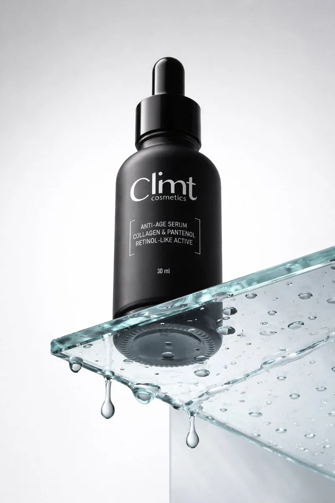

# Harboriis — by @harboriis

[← Back to Examples from X](../../EXAMPLES.md) · Category: Product & Brand · Model: `GPT Image`

<a href="https://x.com/harboriis/status/2018215856577360311"></a>

Original post: **[@harboriis on X](https://x.com/harboriis/status/2018215856577360311)** · Creator: [Harboriis](https://x.com/harboriis)

## Prompt

```text
Commercial luxury product photography, photorealistic, ultra high detail, 8K quality. A minimalist matte black cosmetic dropper bottle placed on a clear glass podium. Low angle camera view to make the bottle feel tall and powerful. The bottom of the bottle is clearly visible through the transparent glass. The glass surface is wet with realistic water droplets, with a few drops hanging underneath the glass, frozen mid drip for a time stopped effect. Matte light gray background with no texture or gradient. Soft, even studio lighting with clean reflections, premium skincare advertising look, sharp focus, realistic materials, no distractions.
```

## Try it

Paste the prompt into **[vinano.ai](https://vinano.ai?utm_source=github&utm_medium=readme&utm_campaign=awesome-image-video-prompts-updating&utm_content=x-page-try)** to generate your own version.

> The image and prompt belong to [@harboriis](https://x.com/harboriis) and are shown here with credit for reference. Creators can ask for changes or removal by opening an issue.
