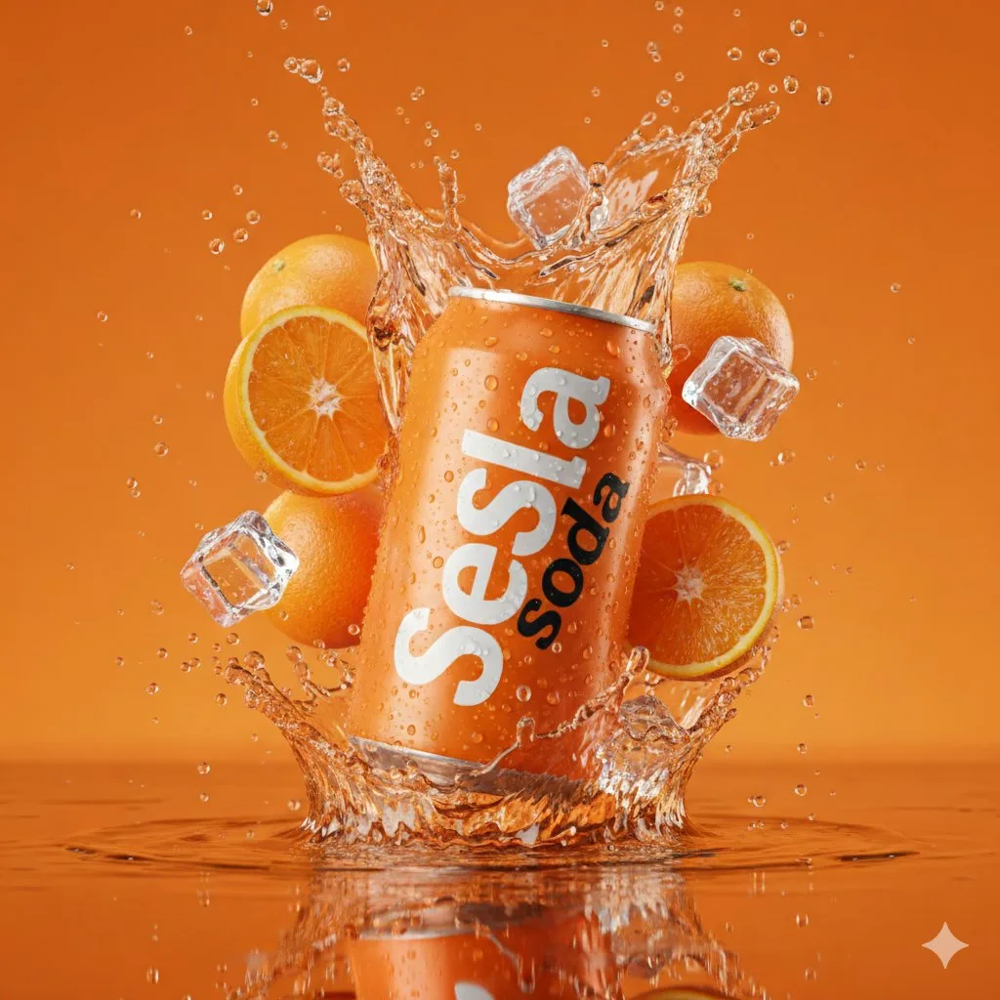

# Meem — by @mehvishs25

[← Back to Community Examples](../../EXAMPLES.md) · Category: Product & Brand · Model: `GPT Image`

<a href="https://x.com/mehvishs25/status/2018525109041135790"></a>

Source: **[@mehvishs25 on X](https://x.com/mehvishs25/status/2018525109041135790)** · Creator: [Meem](https://x.com/mehvishs25)

## Prompt

```text
{
  "master_prompt": {
    "global_settings": {
      "resolution": "8K ultra-high-definition",
      "aspect_ratio": "3:4 vertical",
      "style": "hyper-realistic AI-edited commercial product photography",
      "sharpness": "extreme clarity, micro-detail visibility",
      "lighting_quality": "cinematic studio lighting with controlled highlights and shadows",
      "motion_freeze": "high-speed capture, frozen splashes and particles",
      "noise": "none",
      "artifacts": "none"
    },

"module_1_image_1_style": {
      "subject": {
        "type": "orange-flavored soda can",
        "color": "bright orange",
        "surface_details": "condensation droplets across can",
        "branding_text_visible": [
          "Sesla",
          "cola"
        ]
      },
      "pose_and_orientation": {
        "position": "upright, slightly embedded in splash",
        "angle": "centered frontal view"
      },
      "liquid_and_motion": {
        "liquid_color": "transparent orange-tinted liquid",
        "motion": "high-energy splash bursting upward and outward",
        "splash_detail": "clear liquid arcs with suspended droplets"
      },
      "floating_elements": {
        "oranges": [
          "whole oranges",
          "halved oranges with visible pulp"
        ],
        "ice_cubes": "clear sharp-edged cubes floating mid-air",
        "droplets": "numerous spherical liquid droplets"
      },
      "background": {
        "color": "solid bright orange",
        "lighting": "high-key, evenly lit"
      },
      "surface_and_reflection": {
        "base": "shallow liquid pool",
        "reflection_quality": "strong mirror-like reflection with ripples"
      }
    }
  }
}
```

## Try it

Paste the prompt into **[vinano.ai](https://vinano.ai?utm_source=github&utm_medium=readme&utm_campaign=awesome-image-video-prompts-updating&utm_content=x-page-try)** to generate your own version.

> The image and prompt belong to @mehvishs25 ([original post](https://x.com/mehvishs25/status/2018525109041135790)) and are shown here with credit for reference. Creators can ask for changes or removal by opening an issue.
