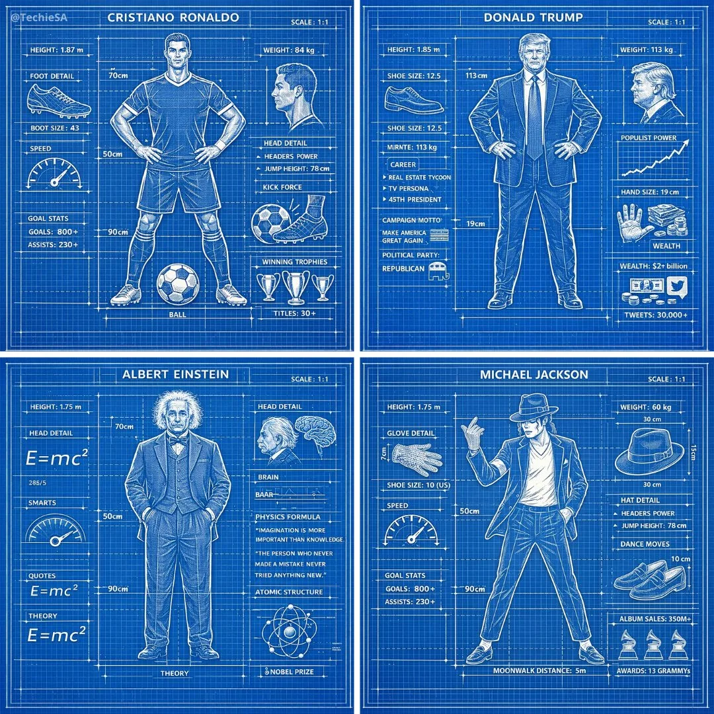

# TechieSA — by @TechieBySA

[← Back to Community Examples](../../EXAMPLES.md) · Category: Product & Brand · Model: `GPT Image`

<a href="https://x.com/TechieBySA/status/2009585651554116028"></a>

Source: **[@TechieBySA on X](https://x.com/TechieBySA/status/2009585651554116028)** · Creator: [TechieSA](https://x.com/TechieBySA)

## Prompt

```text
A detailed technical blueprint illustration of [CHARACTER], drawn in blueprint style on a blue grid background with precise white linework. Includes subtle measurement markings, labels, and schematic-style annotations around the figure. The design is clean, symmetrical, and centered, giving it the look of a professional engineering drawing.
```

## Try it

Paste the prompt into **[vinano.ai](https://vinano.ai?utm_source=github&utm_medium=readme&utm_campaign=awesome-image-video-prompts-updating&utm_content=x-page-try)** to generate your own version.

> The image and prompt belong to @TechieBySA ([original post](https://x.com/TechieBySA/status/2009585651554116028)) and are shown here with credit for reference. Creators can ask for changes or removal by opening an issue.
