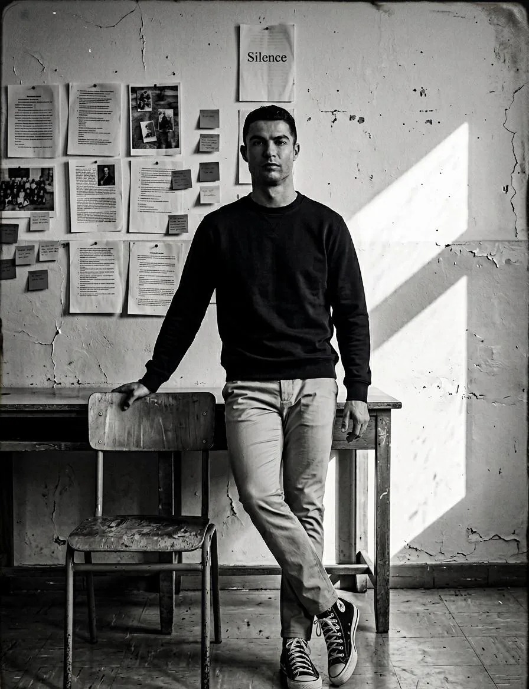

# simeon-sanai — by @Naiknelofar788

[← Back to Examples from X](../../EXAMPLES.md) · Category: Photography · Model: `GPT Image`

<a href="https://x.com/Naiknelofar788/status/2028623800313798810"></a>

Original post: **[@Naiknelofar788 on X](https://x.com/Naiknelofar788/status/2028623800313798810)** · Creator: [simeon-sanai](https://x.com/Naiknelofar788)

## Prompt

```text
Create a high-contrast black and white portrait in a quiet classroom.Use uploaded image as reference. Person leans casually on a wooden school chair, legs crossed, wearing a navy blue sweatshirt, beige chinos, and black-and-white Converse sneakers. calm neutral expression. His left arm rests on the desk, his right hand drops casually to the side. Behind him, an off-white classroom wall with visible wear, pinned papers, photos, and sticky notes in a grid. One page clearly shows the printed word “Silence”, positioned above his head. Sunlight enters sharply from the right, casting a triangular beam of light on the wall and her shadow. The contrast is dramatic, cinematic, and natural, with a warm late-afternoon tone
```

## Try it

Paste the prompt into **[vinano.ai](https://vinano.ai?utm_source=github&utm_medium=readme&utm_campaign=awesome-image-video-prompts-updating&utm_content=x-page-try)** to generate your own version.

> The image and prompt belong to [@Naiknelofar788](https://x.com/Naiknelofar788) and are shown here with credit for reference. Creators can ask for changes or removal by opening an issue.
