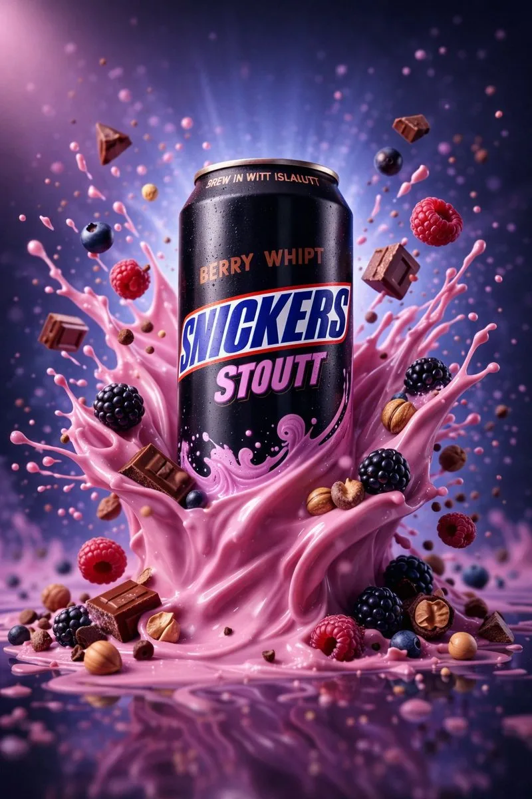

# ShaHid WaNii — by @meng_dagg695

[← Back to Community Examples](../../EXAMPLES.md) · Category: Poster Design · Model: `GPT Image`

<a href="https://x.com/meng_dagg695/status/2011708873418424581"></a>

Source: **[@meng_dagg695 on X](https://x.com/meng_dagg695/status/2011708873418424581)** · Creator: [ShaHid WaNii](https://x.com/meng_dagg695)

## Prompt

```text
{
  "master_prompt": {
    "global_settings": {
      "resolution": "8K ultra-high-definition",
      "aspect_ratio": "3:4 vertical",
      "style": "hyper-realistic AI-edited commercial product photography",
      "sharpness": "extreme clarity, micro-detail visibility",
      "lighting_quality": "cinematic studio lighting with controlled highlights and shadows",
      "motion_freeze": "high-speed capture, frozen splashes and particles",
      "noise": "none",
      "artifacts": "none"
    },

    "module_1_image_1_style": {
      "subject": {
        "type": "beverage can",
        "material": "matte black metal",
        "surface_details": "fine condensation droplets evenly distributed",
        "branding_text_visible": [
          "SNICKERS",
          "STOUTT",
          "BERRY WHIPT",
          "BREW IN WITT ISLAUTT"
        ]
      },
      "pose_and_orientation": {
        "position": "upright, centered",
        "angle": "slight forward-facing perspective",
        "scale": "dominant foreground subject"
      },
      "liquid_and_motion": {
        "liquid_color": "glossy pink",
        "liquid_texture": "thick, creamy, whipped consistency",
        "motion": "explosive upward splash wrapping around the can",
        "splash_shape": "curved arcs with sharp liquid peaks and droplets"
      },
      "floating_elements": {
        "berries": [
          "raspberries",
          "blackberries",
          "blueberries"
        ],
        "chocolate_pieces": "rectangular chocolate chunks with sharp edges",
        "nuts": "round and halved nuts scattered near base and mid-air",
        "distribution": "suspended at various depths around the can"
      },
      "background": {
        "color_gradient": "purple to blue",
        "light_effects": "soft radial glow behind can",
        "particles": "small pink droplets and specks floating"
      },
      "surface_and_reflection": {
        "base": "glossy reflective surface",
        "reflection_quality": "clear mirrored reflection with slight ripple distortion"
      }
    },

    "module_2_image_2_style": {
      "subject": {
        "type": "plastic protein drink bottle",
        "color": "deep matte blue",
        "surface_details": "condensation droplets across entire bottle",
        "label_text_visible": [
          "milk & yogurt",
          "mock up",
          "protein",
          "SEPARATED SHADOWS"
        ]
      },
      "pose_and_orientation": {
        "position": "slightly tilted to the right",
        "angle": "three-quarter view",
        "motion_feel": "dynamic, leaning into splash"
      },
      "liquid_and_motion": {
        "liquid_color": "white and light beige milk mixture",
        "texture": "smooth, creamy, fluid",
        "motion": "swirling splash rising around bottle base and sides"
      },
      "floating_elements": {
        "blueberries": "whole and halved blueberries at different depths",
        "mint_leaves": "small green leaves with visible veins",
        "droplets": "milk droplets and spheres suspended mid-air"
      },
      "background": {
        "color_gradient": "dark blue to warm amber",
        "bokeh": "soft circular light particles scattered throughout"
      },
      "surface_and_reflection": {
        "base": "matte ground with light liquid pooling",
        "shadow_style": "soft separated shadow under bottle"
      }
    },
```

## Try it

Paste the prompt into **[vinano.ai](https://vinano.ai?utm_source=github&utm_medium=readme&utm_campaign=awesome-image-video-prompts-updating&utm_content=x-page-try)** to generate your own version.

> The image and prompt belong to @meng_dagg695 ([original post](https://x.com/meng_dagg695/status/2011708873418424581)) and are shown here with credit for reference. Creators can ask for changes or removal by opening an issue.
