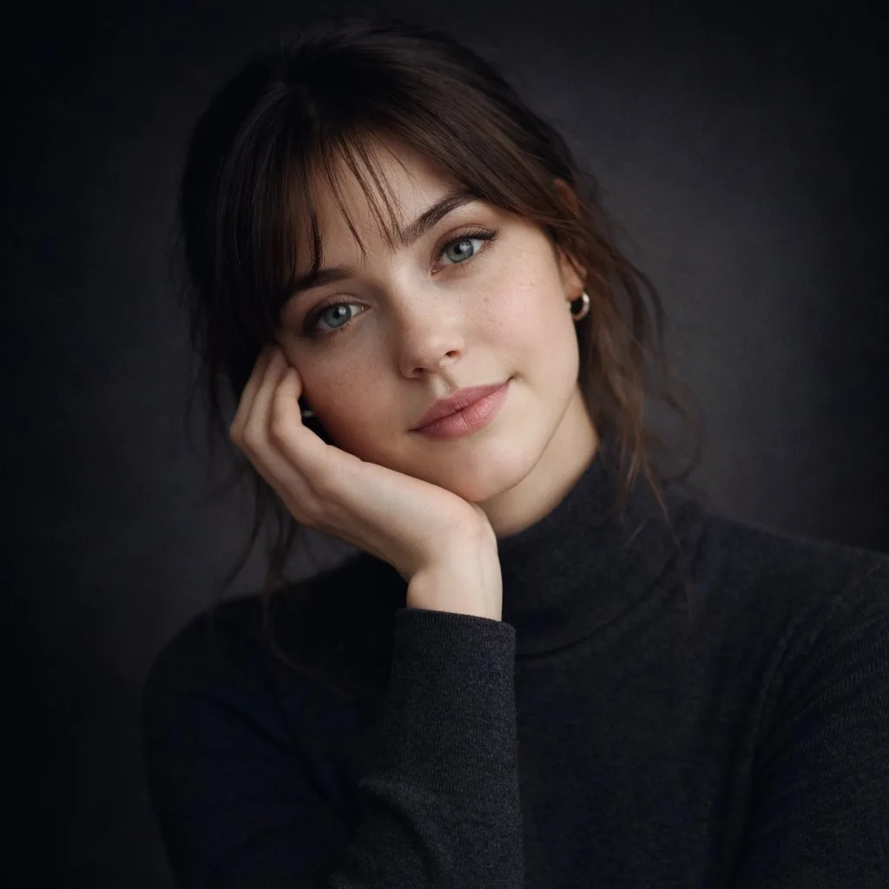

# simeon-sanai — by @Naiknelofar788

[← Back to Community Examples](../../EXAMPLES.md) · Category: Photography · Model: `GPT Image`

<a href="https://x.com/Naiknelofar788/status/2011645375460057533"></a>

Source: **[@Naiknelofar788 on X](https://x.com/Naiknelofar788/status/2011645375460057533)** · Creator: [simeon-sanai](https://x.com/Naiknelofar788)

## Prompt

```text
Ultra-realistic studio portrait of a young woman, front-facing, centered composition, symmetrical face, pale skin with soft cheeks and nose, light gray-blue eyes with a subtle dark limbal ring, soft neutral makeup, slightly glossy natural lips, faint smoky eyeliner, dark brown slightly messy hair with wispy bangs framing the forehead, a few loose strands around the face, wearing a dark gray fitted turtleneck sweater, small silver hoop earrings, calm neutral expression, looking directly into the camera, soft diffused cinematic lighting from the front and side, smooth gradient dark background, shallow depth of field, 85mm lens look, f1.8, ultra sharp focus, hyper-detailed skin texture, photorealistic, 8k, high dynamic range, professional studio photography, no text, no watermark, no logo, no signature, no artifacts.
```

## Try it

Paste the prompt into **[vinano.ai](https://vinano.ai?utm_source=github&utm_medium=readme&utm_campaign=awesome-image-video-prompts-updating&utm_content=x-page-try)** to generate your own version.

> The image and prompt belong to @Naiknelofar788 ([original post](https://x.com/Naiknelofar788/status/2011645375460057533)) and are shown here with credit for reference. Creators can ask for changes or removal by opening an issue.
