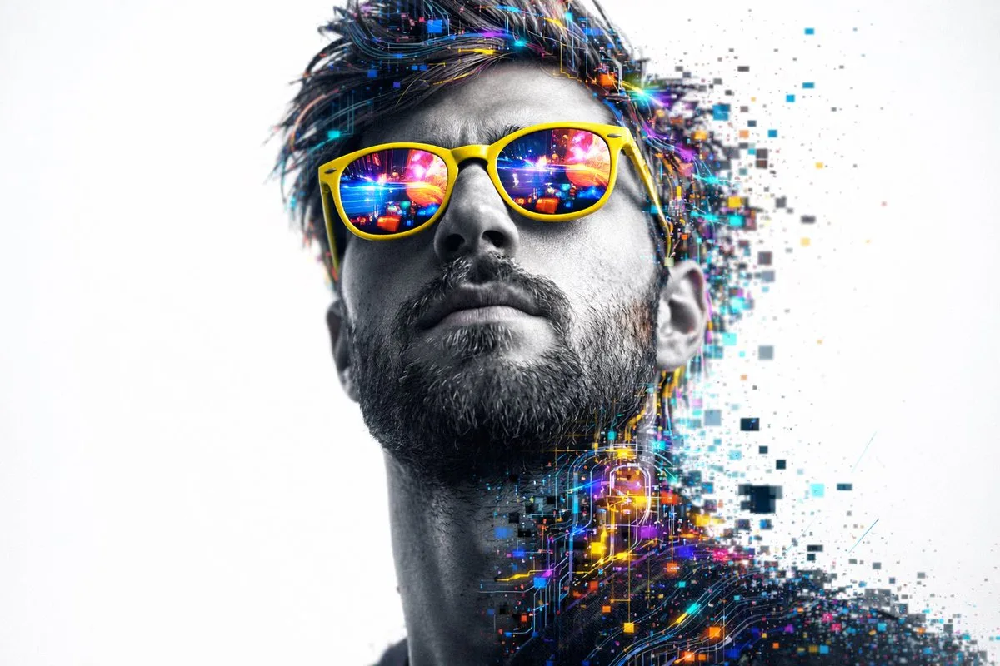

# Duet | AI — by @Sheldon056

[← Back to Examples from X](../../EXAMPLES.md) · Category: UI & Graphic · Model: `GPT Image`

<a href="https://x.com/Sheldon056/status/2016088197714084320"></a>

Original post: **[@Sheldon056 on X](https://x.com/Sheldon056/status/2016088197714084320)** · Creator: [Duet | AI](https://x.com/Sheldon056)

## Prompt

```text
A hyper-realistic 8K close-up portrait of a person's head and upper neck, shot from a slightly low-angle perspective looking upward.
Use the uploaded image as the face reference - the face must match 100% exactly (same identity, facial structure, proportions, skin details, and expression). Do not alter the face in any way.
The subject is wearing bright yellow sunglasses with reflective lenses showing colorful abstract digital scenes in shades of pink, blue, and yellow.
The face is rendered in detailed grayscale, showing realistic skin texture, pores, and light stubble on the jawline, creating strong contrast with the rest of the head.
The hair and most of the head and neck are made of glowing digital circuit patterns, abstract shapes, lines, and data streams in vibrant colors like magenta, cyan, blue, green, yellow, and orange. These elements appear layered and complex, with a soft internal glow.
Parts of the digital head are breaking apart and dissolving outward into pixels, lines, and glitch fragments that fade into a clean white background, giving a glitch-art, futuristic look.
Cinematic lighting highlights one side of the face, with shadows under the chin and subtle rim lighting around the digital elements.
Overall style is futuristic, cyber-inspired, high-detail, and photorealistic.
```

## Try it

Paste the prompt into **[vinano.ai](https://vinano.ai?utm_source=github&utm_medium=readme&utm_campaign=awesome-image-video-prompts-updating&utm_content=x-page-try)** to generate your own version.

> The image and prompt belong to [@Sheldon056](https://x.com/Sheldon056) and are shown here with credit for reference. Creators can ask for changes or removal by opening an issue.
