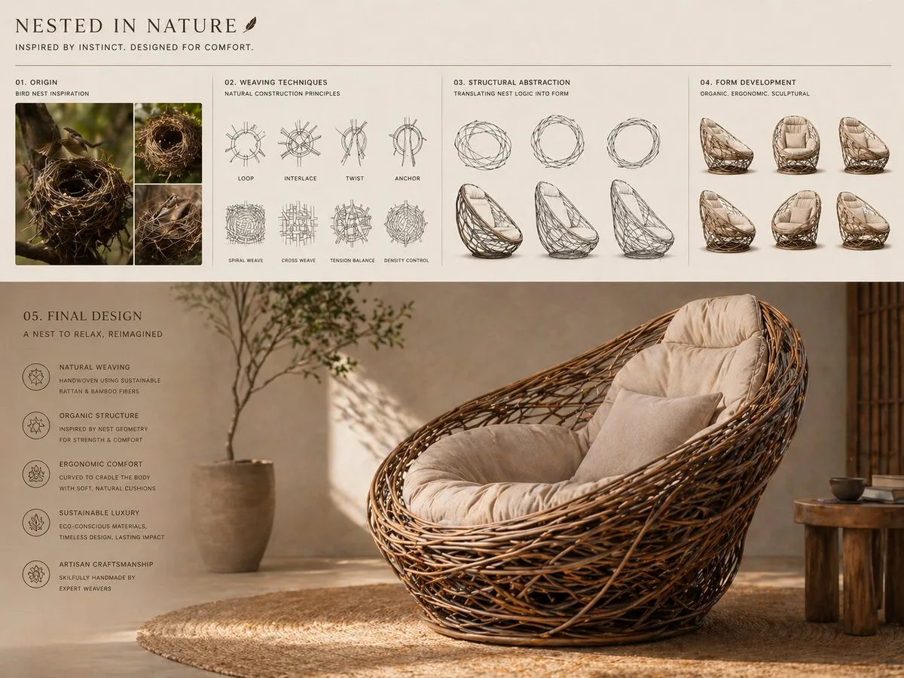

# Aleena Amir — by @aleenaamiir

[← Back to Community Examples](../../EXAMPLES.md) · Category: Product & Brand · Model: `GPT Image`

<a href="https://x.com/aleenaamiir/status/2048667175112802778"></a>

Source: **[@aleenaamiir on X](https://x.com/aleenaamiir/status/2048667175112802778)** · Creator: [Aleena Amir](https://x.com/aleenaamiir)

## Prompt

```text
Conceptual transformation, bird nest construction techniques shaping a sculptural lounge chair, sequence from nest-building photography to weaving diagrams to organic structural abstraction to final product, interwoven frame forming seat and backrest, natural fibers with soft cushioning, earthy tones with refined finish, sustainable luxury aesthetic, presentation layout, sketches above, render below, warm natural lighting.

AR – 4:3
```

## Try it

Paste the prompt into **[vinano.ai](https://vinano.ai?utm_source=github&utm_medium=readme&utm_campaign=awesome-image-video-prompts-updating&utm_content=x-page-try)** to generate your own version.

> The image and prompt belong to @aleenaamiir ([original post](https://x.com/aleenaamiir/status/2048667175112802778)) and are shown here with credit for reference. Creators can ask for changes or removal by opening an issue.
