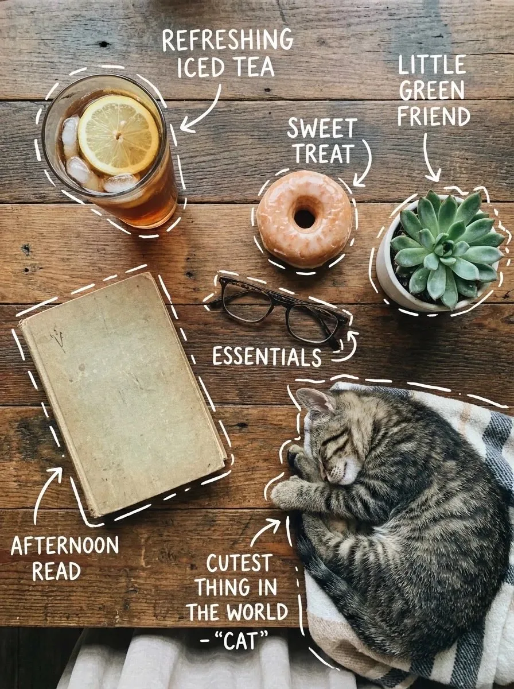

# Sairah — by @Sairah_0

[← Back to Examples from X](../../EXAMPLES.md) · Category: Food & Drink · Model: `GPT Image`

<a href="https://x.com/Sairah_0/status/2048725842096976020"></a>

Original post: **[@Sairah_0 on X](https://x.com/Sairah_0/status/2048725842096976020)** · Creator: [Sairah](https://x.com/Sairah_0)

## Prompt

```text
Top-down flat lay on a rustic wooden table, cozy aesthetic, soft natural light. A glass of iced tea with lemon slices and ice cubes, a glazed donut, a small succulent plant in a white pot, a vintage book, and eyeglasses. A sleeping tabby cat curled on a blanket at the edge. White hand-drawn doodle outlines and arrows around each object with playful handwritten labels like “refreshing iced tea,” “sweet treat,” “little green friend,” “afternoon read,” and “cutest thing in the world – cat.” Warm tones, minimal shadows, lifestyle photography, high detail, Instagram aesthetic.
```

## Try it

Paste the prompt into **[vinano.ai](https://vinano.ai?utm_source=github&utm_medium=readme&utm_campaign=awesome-image-video-prompts-updating&utm_content=x-page-try)** to generate your own version.

> The image and prompt belong to [@Sairah_0](https://x.com/Sairah_0) and are shown here with credit for reference. Creators can ask for changes or removal by opening an issue.
