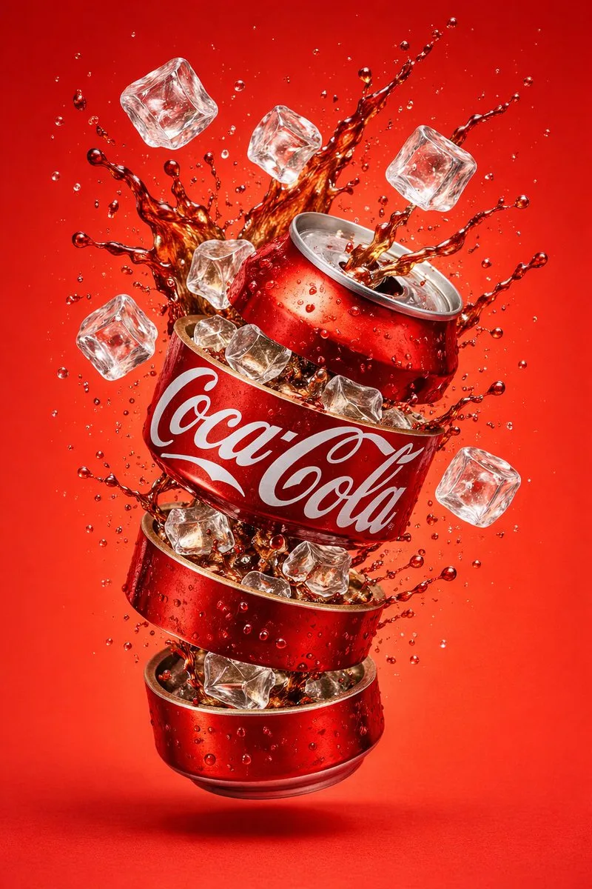

# ShaHid WaNii — by @meng_dagg695

[← Back to Examples from X](../../EXAMPLES.md) · Category: Food & Drink · Model: `GPT Image`

<a href="https://x.com/meng_dagg695/status/2009519057717088345"></a>

Original post: **[@meng_dagg695 on X](https://x.com/meng_dagg695/status/2009519057717088345)** · Creator: [ShaHid WaNii](https://x.com/meng_dagg695)

## Prompt

```text
{
  "resolution": "8K",
  "style": "hyper-realistic commercial product photography",
  "composition": {
    "subject": "carbonated beverage can",
    "position": "center frame, floating mid-air",
    "orientation": "slightly tilted vertical",
    "framing": "tight hero shot"
  },
  "can_details": {
    "material": "metallic aluminum",
    "top_bottom": "silver with visible pull tab",
    "surface": "glossy with condensation droplets",
    "label": {
      "text": "{{BRAND_NAME}}",
      "font": "bold uppercase sans-serif",
      "color": "white",
      "background_band": "deep blue",
      "placement": "wrapped around center of can"
    }
  },
  "liquid_effects": {
    "color": "bright green",
    "type": "carbonated liquid splash",
    "motion": "frozen mid-explosion",
    "details": [
      "semi-transparent fluid",
      "fine droplets suspended in air",
      "dynamic curved splash arcs",
      "visible carbonation bubbles"
    ]
  },
  "fruit_elements": {
    "type": "sliced fruit",
    "motion": "floating around the can",
    "texture": "fresh, juicy, glossy"
  },
  "lighting": {
    "type": "studio lighting",
    "highlights": "strong reflections",
    "shadows": "soft"
  },
  "background": {
    "color": "smooth gradient matching liquid tone",
    "environment": "clean studio backdrop"
  },
  "render_quality": {
    "sharpness": "ultra-sharp",
    "contrast": "high",
    "realism": "photorealistic"
  }
}
```

## Try it

Paste the prompt into **[vinano.ai](https://vinano.ai?utm_source=github&utm_medium=readme&utm_campaign=awesome-image-video-prompts-updating&utm_content=x-page-try)** to generate your own version.

> The image and prompt belong to [@meng_dagg695](https://x.com/meng_dagg695) and are shown here with credit for reference. Creators can ask for changes or removal by opening an issue.
