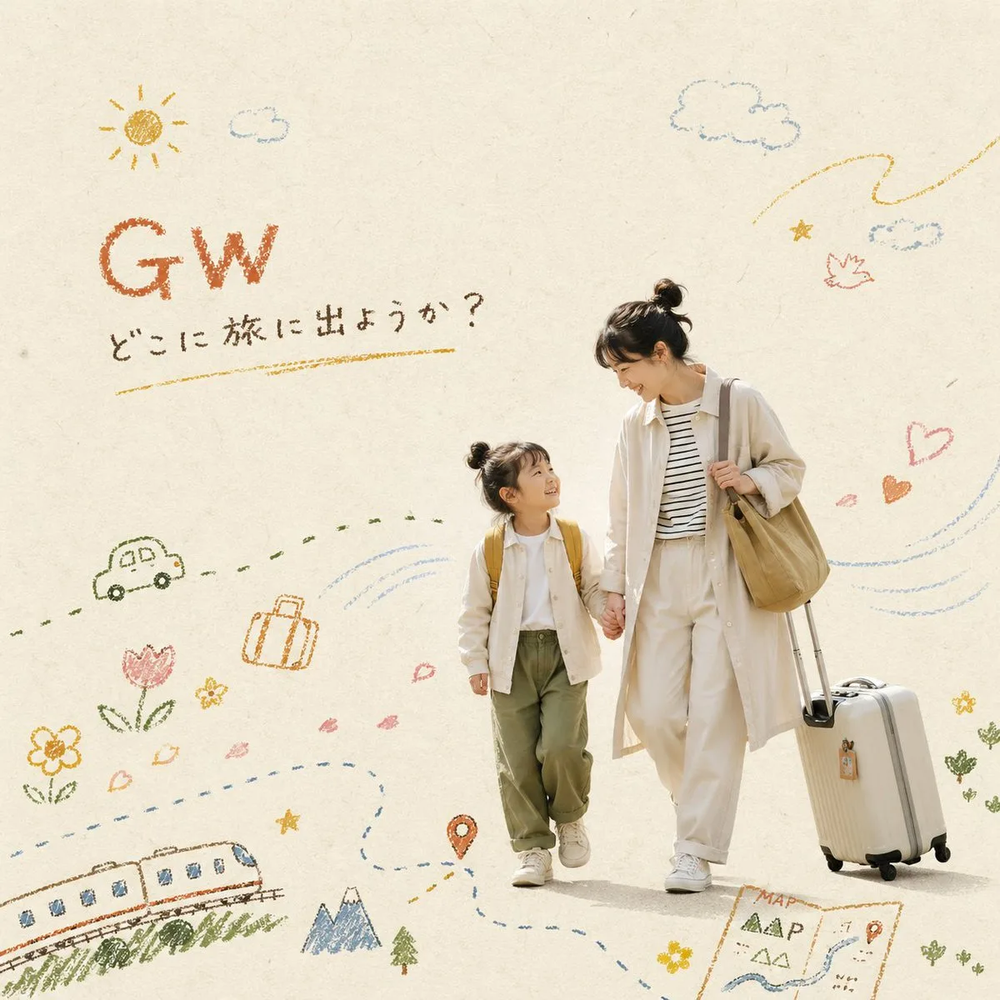

# konmari — by @konmari_tweet

[← Back to Community Examples](../../EXAMPLES.md) · Category: Illustration & 3D · Model: `GPT Image`

<a href="https://x.com/konmari_tweet/status/2048714101850071422"></a>

Source: **[@konmari_tweet on X](https://x.com/konmari_tweet/status/2048714101850071422)** · Creator: [konmari](https://x.com/konmari_tweet)

## Prompt

```text
【テーマ】
{ここにテーマを入力}

【写真】
{ここに使用する写真の内容を簡潔に入力}
（例：公園で遊ぶ子ども / 親子の笑顔 / 走る子ども など）

【タイトル】
{画像内に入れるタイトルを入力}
（例：こどもの日 / Happy Mother's Day / 春のはじまり など）

---

テーマ「{テーマ}」に基づいた、
写真とクレヨンイラストを融合したライフスタイル系エディトリアルビジュアル。

提供された写真をメインビジュアルとして使用する。

■ シーン
「{写真}」に合った自然な日常の瞬間。
作り込みすぎないリアルな空気感、やわらかい自然光、
人物の自然な動きや感情を重視。

■ 構図
人物を切り抜いたように配置し、
ざらっとした紙質のクラフト系背景
（生成り、ベージュ、淡いグレー、ミルクティー）の上にレイアウト。

・余白50%以上
・左右非対称構図
・抜け感のあるミニマルなエディトリアルデザイン

■ イラスト（最重要）
オイルパステル／クレヨンで描いたような、
ざらつきとかすれのある手描きイラストを重ねる。

▼ルール
・全体の30〜40%以内
・線にムラとかすれ、紙のテクスチャが残る
・力の入り具合で濃淡が変化（濃い部分・薄い部分が混在）
・子どもが描いたような少し不器用なタッチ
・影・立体表現は禁止（フラット）
・人物の動きと連動させる（風・軌跡・流れ）

▼モチーフ（テーマ連動）
・{テーマ}を象徴する要素をクレヨンタッチで追加
（例：こどもの日 → 鯉のぼり、風、空、草、雲、紙かぶと）
・風の線、動きの線、小さなアイコン、太陽、雲、お花、ハート、星、ジグザグの動線
・空気感をクレヨンの粗いストロークで演出

■ タイトル文字（重要）
画像内に「{タイトル}」を手描きクレヨン文字で配置する。
・配置は左上または右上の余白部分
・クレヨンで書いたようなざらつき・かすれのある文字
・少し不器用で味のある手書き風
・文字色はアースカラー（テラコッタ、マスタード、ダークブラウン）から選択
・サイズは控えめでミニマルに（主役は写真）
・装飾枠なし、フラット

■ 色
あたたかみのあるアースカラー、
やわらかいくすみカラー
（テラコッタ、マスタード、オリーブ、ミルクティー、淡いブルー）

■ 雰囲気
あたたかい、ノスタルジック、こども心、ハンドメイド感、
やさしい、エモーショナル、ストーリー性のある日常

■ スタイル
絵本的ぬくもり × 北欧ミニマル × 上質なライフスタイル広告

■ 品質
高解像度、商用レベルのクオリティ
```

## Try it

Paste the prompt into **[vinano.ai](https://vinano.ai?utm_source=github&utm_medium=readme&utm_campaign=awesome-image-video-prompts-updating&utm_content=x-page-try)** to generate your own version.

> The image and prompt belong to @konmari_tweet ([original post](https://x.com/konmari_tweet/status/2048714101850071422)) and are shown here with credit for reference. Creators can ask for changes or removal by opening an issue.
