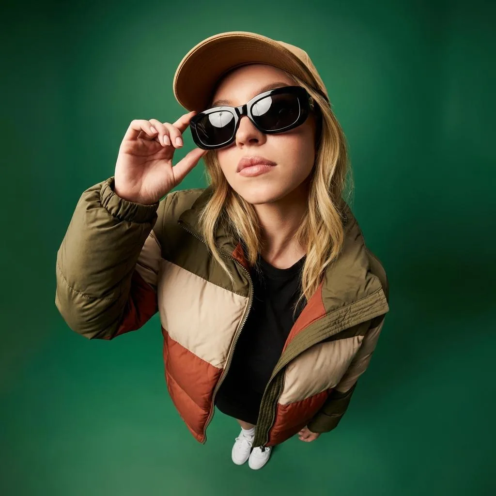

# simeon-sanai — by @Naiknelofar788

[← Back to Community Examples](../../EXAMPLES.md) · Category: Photography · Model: `GPT Image`

<a href="https://x.com/Naiknelofar788/status/2033570946985144647"></a>

Source: **[@Naiknelofar788 on X](https://x.com/Naiknelofar788/status/2033570946985144647)** · Creator: [simeon-sanai](https://x.com/Naiknelofar788)

## Prompt

```text
Convert uploaded photo into ultra-wide 10mm fisheye portrait from dramatic high top-down angle with strong perspective distortion (larger head, compressed body). Add black oversized sunglasses and plain white cap, right hand adjusting cap, confident upward gaze. Color-block puffer jacket (burnt orange/cream/brown), white tee, white sneakers. Bold terracotta studio background, smooth gradient, high contrast, sharp editorial lighting, 8k.
```

## Try it

Paste the prompt into **[vinano.ai](https://vinano.ai?utm_source=github&utm_medium=readme&utm_campaign=awesome-image-video-prompts-updating&utm_content=x-page-try)** to generate your own version.

> The image and prompt belong to @Naiknelofar788 ([original post](https://x.com/Naiknelofar788/status/2033570946985144647)) and are shown here with credit for reference. Creators can ask for changes or removal by opening an issue.
