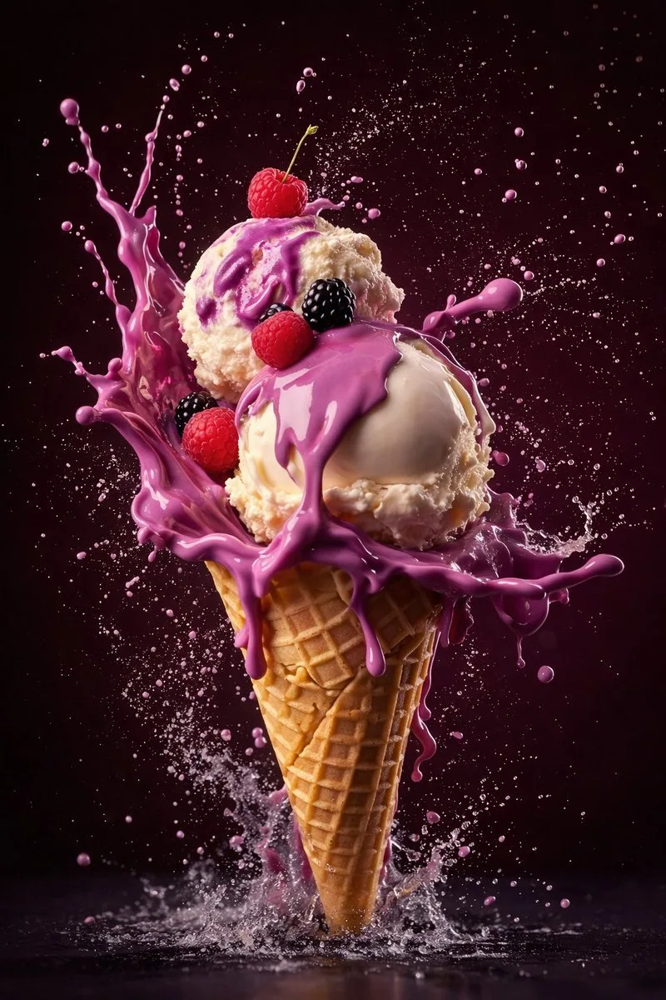

# ShaHid WaNii — by @meng_dagg695

[← Back to Community Examples](../../EXAMPLES.md) · Category: Food & Drink · Model: `GPT Image`

<a href="https://x.com/meng_dagg695/status/2010312584059351261"></a>

Source: **[@meng_dagg695 on X](https://x.com/meng_dagg695/status/2010312584059351261)** · Creator: [ShaHid WaNii](https://x.com/meng_dagg695)

## Prompt

```text
{
  "master_prompt": {
    "global_settings": {
      "resolution": "8K ultra high definition",
      "aspect_ratio": "3:4 vertical",
      "image_quality": "extreme sharpness, high dynamic range, professional studio lighting",
      "style": "AI-edited hyperreal food photography",
      "focus": "crisp textures, frozen motion, liquid dynamics, surface details",
      "background_quality": "clean, controlled, noise-free"
    },

    "module_1": {
      "identity": "Image 1 – Ice Cream Cone with Purple Splash",
      "subject": {
        "main_object": "waffle cone ice cream",
        "cone": "light brown waffle cone with diamond grid texture, matte finish",
        "ice_cream_scoops": [
          {
            "color": "off-white / vanilla",
            "texture": "creamy with visible scoop ridges"
          },
          {
            "color": "off-white / vanilla",
            "texture": "slightly uneven surface, melting edges"
          }
        ],
        "toppings": [
          "raspberries",
          "blackberries"
        ],
        "sauce": {
          "color": "glossy purple",
          "behavior": "thick liquid splashing outward and downward",
          "coverage": "dripping over scoops and cone"
        }
      },
      "motion": {
        "action": "frozen splash moment",
        "details": "liquid droplets suspended mid-air, see-through splash edges"
      },
      "background": {
        "color": "deep dark maroon / black",
        "style": "studio backdrop with subtle gradient"
      },
      "lighting": {
        "type": "high-contrast studio lighting",
        "effects": "specular highlights on sauce and ice cream, shadow depth under cone"
      }
    },

    "module_2": {
      "identity": "Image 2 – Chocolate Ice Cream Bar with Bite",
      "subject": {
        "main_object": "chocolate-coated ice cream bar on wooden stick",
        "coating": {
          "exploded_view": false,
          "surface": "milk chocolate coating with embedded nut pieces",
          "texture": "rough, uneven, crunchy appearance"
        },
        "bite_detail": {
          "location": "top edge",
          "interior_layers": [
            "chocolate ice cream",
            "thin darker chocolate layer"
          ],
          "edges": "jagged bite marks"
        },
        "stick": {
          "material": "light wood",
          "finish": "smooth, rounded end"
        }
      },
      "motion": {
        "elements": "small chocolate fragments floating in air",
        "behavior": "scattered outward from the bar"
      },
      "background": {
        "color": "warm brown gradient",
        "style": "clean studio environment"
      },
      "lighting": {
        "type": "directional studio lighting",
        "effects": "strong highlights on chocolate bumps, soft shadows"
      }
    },

    "module_3": {
      "identity": "Image 3 – Red Berry Popsicle with Fruits",
      "subject": {
        "main_object": "rectangular red popsicle",
        "surface": {
          "texture": "frosted, icy crystals visible",
          "shape": "rounded corners, vertical grooves"
        },
        "stick": {
          "material": "light wooden stick",
          "visible": true
        },
        "surroundings": [
          "whole strawberries with green tops",
          "blueberries",
          "raspberries",
          "mint leaves",
          "crushed ice pieces"
        ]
      },
      "color_palette": [
        "bright red",
        "deep blue",
        "fresh green",
        "clear ice"
      ],
      "background": {
        "composition": "entire frame filled with fruits and ice",
        "style": "top-down macro food arrangement"
      },
      "lighting": {
        "type": "even bright lighting",
        "effects": "wet shine on fruit skins, crystalline ice reflections"
      }
    },
```

## Try it

Paste the prompt into **[vinano.ai](https://vinano.ai?utm_source=github&utm_medium=readme&utm_campaign=awesome-image-video-prompts-updating&utm_content=x-page-try)** to generate your own version.

> The image and prompt belong to @meng_dagg695 ([original post](https://x.com/meng_dagg695/status/2010312584059351261)) and are shown here with credit for reference. Creators can ask for changes or removal by opening an issue.
