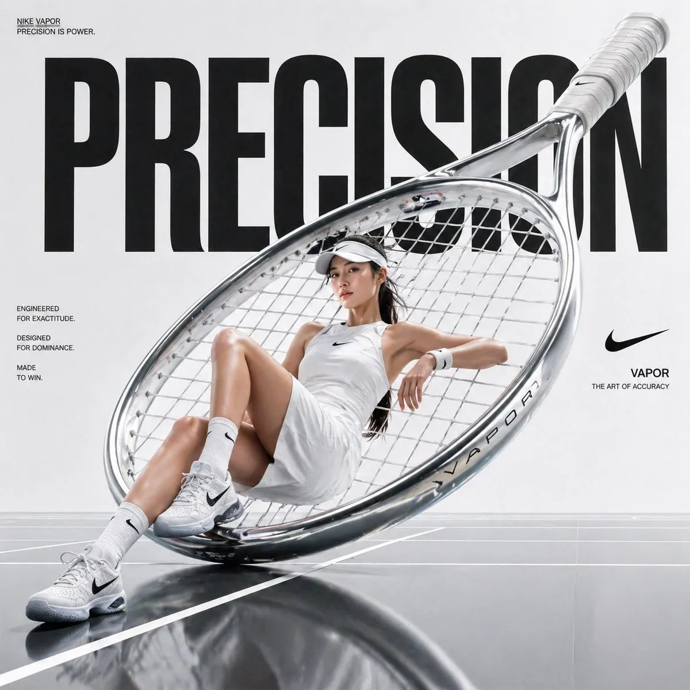

# Aron厚玉 — by @aronhouyu

[← Back to Community Examples](../../EXAMPLES.md) · Category: Poster Design · Model: `GPT Image`

<a href="https://x.com/aronhouyu/status/2047989228274118901"></a>

Source: **[@aronhouyu on X](https://x.com/aronhouyu/status/2047989228274118901)** · Creator: [Aron厚玉](https://x.com/aronhouyu)

## Prompt

```text
Avant-garde sports fashion advertisement, oversized tennis racket positioned like monumental sculpture, female athlete seated casually on the strings as if a suspended lounge, giant word “PRECISION” in bold typography behind, crisp white studio backdrop, reflective court-like floor, luxury sportswear editorial aesthetic, cinematic lighting, ultra-clean composition, 1:1
```

## Try it

Paste the prompt into **[vinano.ai](https://vinano.ai?utm_source=github&utm_medium=readme&utm_campaign=awesome-image-video-prompts-updating&utm_content=x-page-try)** to generate your own version.

> The image and prompt belong to @aronhouyu ([original post](https://x.com/aronhouyu/status/2047989228274118901)) and are shown here with credit for reference. Creators can ask for changes or removal by opening an issue.
