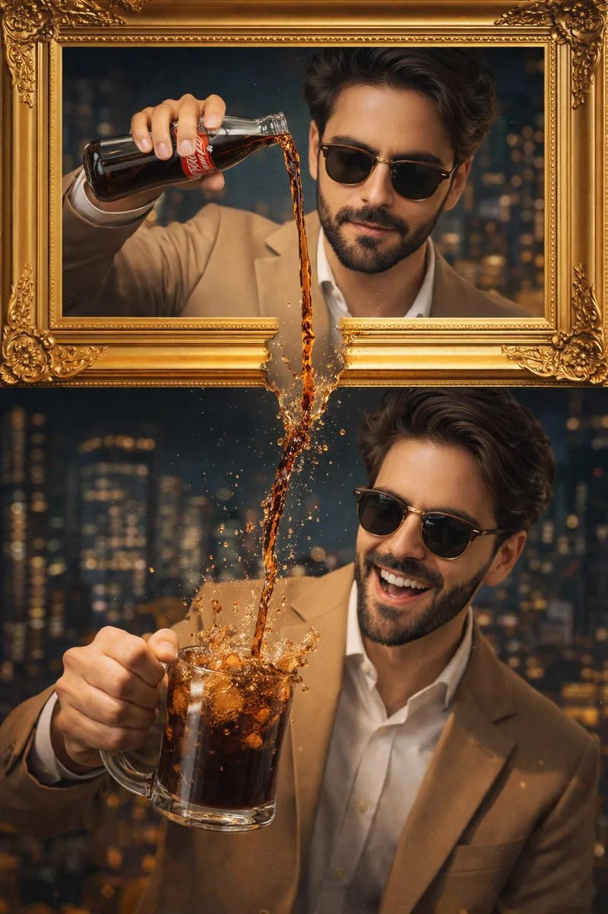

# Zar⭕on — by @Xaroonx

[← Back to Community Examples](../../EXAMPLES.md) · Category: Photography · Model: `GPT Image`

<a href="https://x.com/Xaroonx/status/2005541752187273292"></a>

Source: **[@Xaroonx on X](https://x.com/Xaroonx/status/2005541752187273292)** · Creator: [Zar⭕on](https://x.com/Xaroonx)

## Prompt

```text
A stylish man wearing a tan suit and sunglasses is featured in a creative split image, framed by two ornate gold frames. In the top frame, he is pouring Coca-Cola from a bottle. The cola streams downward, passing through the gap between the frames. In the bottom frame, the same man, also in a tan suit and sunglasses, is shown with a joyful expression as the stream of cola splashes into a glass mug he is holding, creating a dynamic splash.The background behind the frames is a softly blurred night cityscape with tall buildings and lights, suggesting.
```

## Try it

Paste the prompt into **[vinano.ai](https://vinano.ai?utm_source=github&utm_medium=readme&utm_campaign=awesome-image-video-prompts-updating&utm_content=x-page-try)** to generate your own version.

> The image and prompt belong to @Xaroonx ([original post](https://x.com/Xaroonx/status/2005541752187273292)) and are shown here with credit for reference. Creators can ask for changes or removal by opening an issue.
