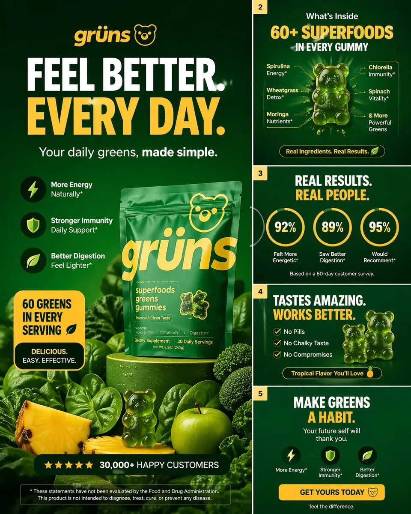

# Oliver Kenyon — by @oliverkenyon

[← Back to Examples from X](../../EXAMPLES.md) · Category: Product & Brand · Model: `GPT Image`

<a href="https://x.com/oliverkenyon/status/2047064581051142166"></a>

Original post: **[@oliverkenyon on X](https://x.com/oliverkenyon/status/2047064581051142166)** · Creator: [Oliver Kenyon](https://x.com/oliverkenyon)

## Prompt

```text
Create a high-converting carousel image for Grüns (greens gummies).
Bold hook, clear outcome, premium DTC design.
Mobile-first, 4:5, advanced design level.
```

## Try it

Paste the prompt into **[vinano.ai](https://vinano.ai?utm_source=github&utm_medium=readme&utm_campaign=awesome-image-video-prompts-updating&utm_content=x-page-try)** to generate your own version.

> The image and prompt belong to [@oliverkenyon](https://x.com/oliverkenyon) and are shown here with credit for reference. Creators can ask for changes or removal by opening an issue.
