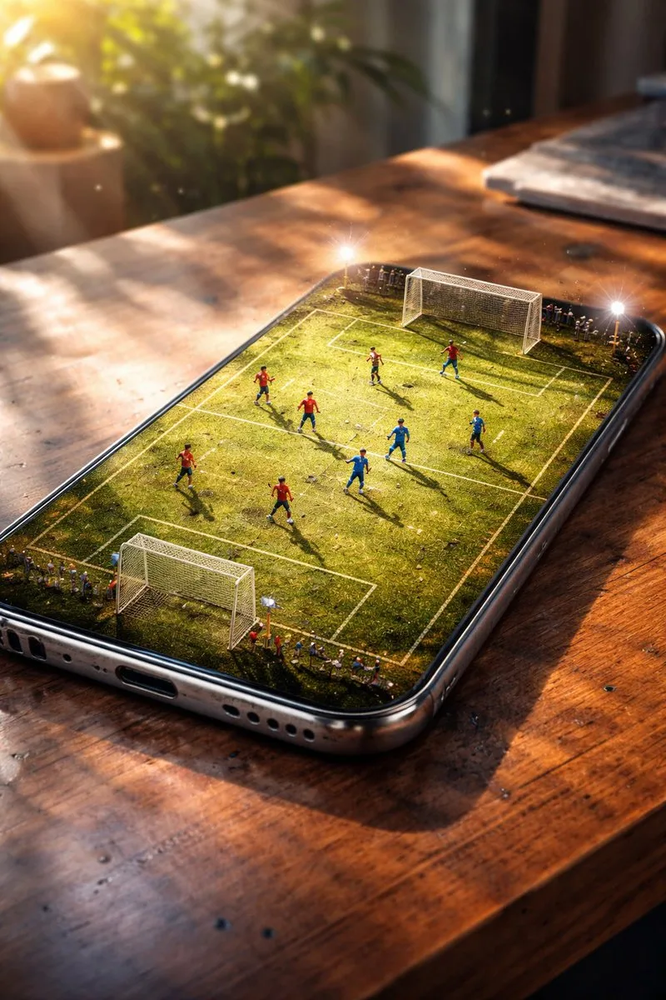

# 𝐌 — by @Strength04_X

[← Back to Examples from X](../../EXAMPLES.md) · Category: Illustration & 3D · Model: `GPT Image`

<a href="https://x.com/Strength04_X/status/2006679801256656925"></a>

Original post: **[@Strength04_X on X](https://x.com/Strength04_X/status/2006679801256656925)** · Creator: [𝐌](https://x.com/Strength04_X)

## Prompt

```text
{
  "type": "image_generation",
  "style": "hyper_realistic",
  "quality": "8K DSLR",
  "aspect_ratio": "4:5",
  "camera": {
    "angle": "slightly tilted cinematic perspective",
    "lens": "50mm DSLR",
    "depth_of_field": "shallow",
    "focus": "smartphone and football action"
  },
  "scene": {
    "setting": "smartphone placed on a wooden table",
    "concept": "phone screen transformed into a miniature football stadium",
    "environment": "indoor, soft daylight coming from the side",
    "atmosphere": "cinematic, immersive, realistic"
  },
  "details": {
    "screen": "weathered green football pitch with visible wear, dirt patches, and grass texture",
    "players": "miniature football players actively playing a match with dynamic poses",
    "lighting": "soft diffused daylight with subtle lens flares and realistic reflections",
    "realism_effects": [
      "fingerprints on screen",
      "light scratches on phone body",
      "natural smudges",
      "micro dust particles"
    ]
  },
  "materials": {
    "phone": "metallic frame with realistic reflections",
    "table": "textured wooden surface with warm tones"
  },
  "mood": "high-end cinematic, dramatic, premium advertising look",
  "rendering": {
    "sharpness": "ultra sharp",
    "texture_detail": "extreme",
    "lighting_quality": "studio grade",
    "photorealism": true
  }
}
```

## Try it

Paste the prompt into **[vinano.ai](https://vinano.ai?utm_source=github&utm_medium=readme&utm_campaign=awesome-image-video-prompts-updating&utm_content=x-page-try)** to generate your own version.

> The image and prompt belong to [@Strength04_X](https://x.com/Strength04_X) and are shown here with credit for reference. Creators can ask for changes or removal by opening an issue.
