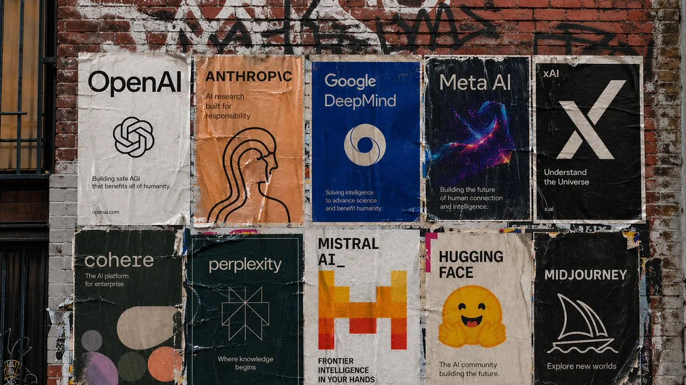

# Justine Moore — by @venturetwins

[← Back to Community Examples](../../EXAMPLES.md) · Category: Poster Design · Model: `GPT Image`

<a href="https://x.com/venturetwins/status/2046700418554851630"></a>

Source: **[@venturetwins on X](https://x.com/venturetwins/status/2046700418554851630)** · Creator: [Justine Moore](https://x.com/venturetwins)

## Prompt

```text
Make a wheatpaste poster setup on a brick wall in sf featuring posters from various AI labs
```

## Try it

Paste the prompt into **[vinano.ai](https://vinano.ai?utm_source=github&utm_medium=readme&utm_campaign=awesome-image-video-prompts-updating&utm_content=x-page-try)** to generate your own version.

> The image and prompt belong to @venturetwins ([original post](https://x.com/venturetwins/status/2046700418554851630)) and are shown here with credit for reference. Creators can ask for changes or removal by opening an issue.
