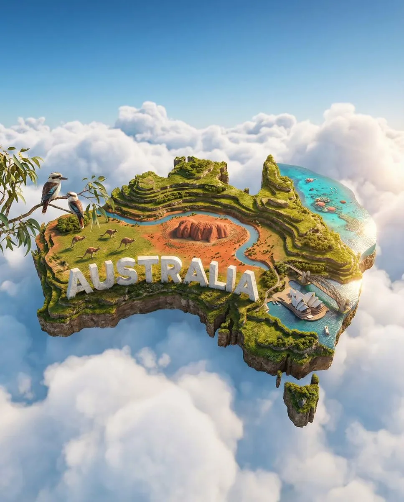

# simeon-sanai — by @Naiknelofar788

[← Back to Community Examples](../../EXAMPLES.md) · Category: Illustration & 3D · Model: `GPT Image`

<a href="https://x.com/Naiknelofar788/status/2024277162652815403"></a>

Source: **[@Naiknelofar788 on X](https://x.com/Naiknelofar788/status/2024277162652815403)** · Creator: [simeon-sanai](https://x.com/Naiknelofar788)

## Prompt

```text
Create an ultra-HD, hyper-realistic digital poster of a floating miniature island shaped like [Country], resting on white clouds in the sky. Blend iconic landmarks, natural landscapes (like [landmark 1], [landscape 2], or [landscape 3]), and cultural elements unique to [Country]. Carve "[Country]" into the terrain using large white 3D letters. Add artistic details like [wildlife], cinematic lighting, vivid colors, aerial perspective, and sun reflections to enhance realism
```

## Try it

Paste the prompt into **[vinano.ai](https://vinano.ai?utm_source=github&utm_medium=readme&utm_campaign=awesome-image-video-prompts-updating&utm_content=x-page-try)** to generate your own version.

> The image and prompt belong to @Naiknelofar788 ([original post](https://x.com/Naiknelofar788/status/2024277162652815403)) and are shown here with credit for reference. Creators can ask for changes or removal by opening an issue.
