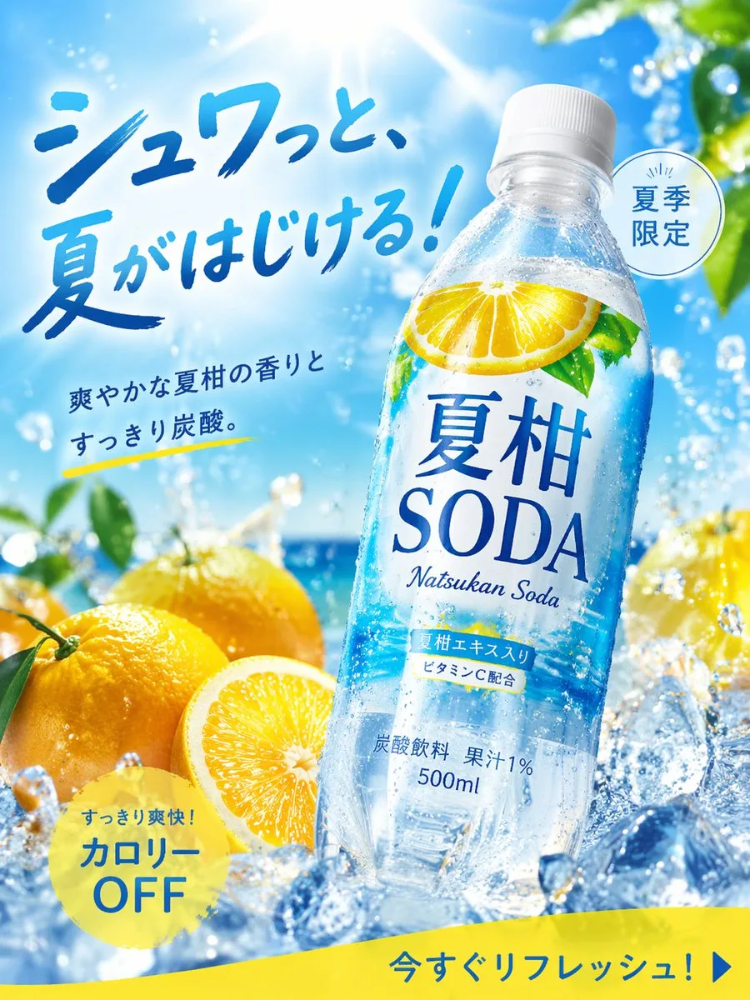

# いにしえ@AI Director &amp; Creator｜Will Oldgram — by @old_pgmrs_will

[← Back to Examples from X](../../EXAMPLES.md) · Category: Poster Design · Model: `GPT Image`

<a href="https://x.com/old_pgmrs_will/status/2045852114673635507"></a>

Original post: **[@old_pgmrs_will on X](https://x.com/old_pgmrs_will/status/2045852114673635507)** · Creator: [いにしえ@AI Director &amp; Creator｜Will Oldgram](https://x.com/old_pgmrs_will)

## Prompt

```text
画像生成: 商品広告写真, 夏にぴったりの季節商品, 炭酸飲料, 名称="夏柑SODA", 形状=ペットボトル500ml, 2025年に飲料広告として高CTAだったデザインをリサーチしてから画像仕様をデザインして生成, アスペクト比=3:4
```

## Try it

Paste the prompt into **[vinano.ai](https://vinano.ai?utm_source=github&utm_medium=readme&utm_campaign=awesome-image-video-prompts-updating&utm_content=x-page-try)** to generate your own version.

> The image and prompt belong to [@old_pgmrs_will](https://x.com/old_pgmrs_will) and are shown here with credit for reference. Creators can ask for changes or removal by opening an issue.
