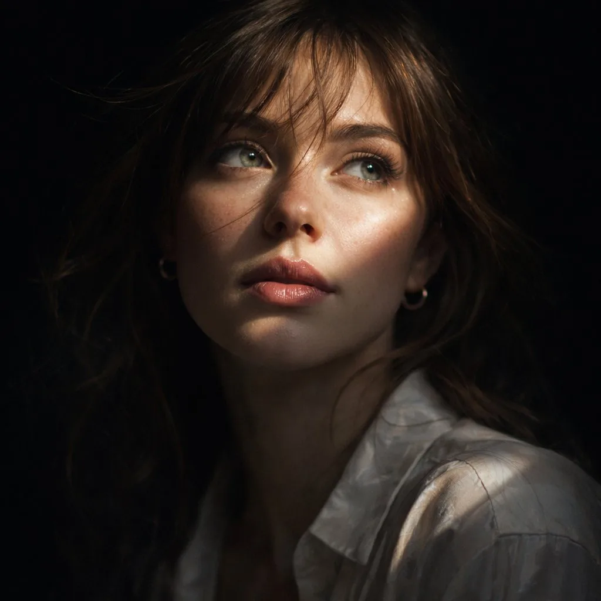

# simeon-sanai — by @Naiknelofar788

[← Back to Examples from X](../../EXAMPLES.md) · Category: Photography · Model: `GPT Image`

<a href="https://x.com/Naiknelofar788/status/2028853502358003808"></a>

Original post: **[@Naiknelofar788 on X](https://x.com/Naiknelofar788/status/2028853502358003808)** · Creator: [simeon-sanai](https://x.com/Naiknelofar788)

## Prompt

```text
Hyper-realistic cinematic Create an 8k close-up portrait of a beautiful woman with medium, brown, slightly wind-swept hair falling across her face. Her striking, light-colored eyes gaze upwards and to the right, catching a sharp, diagonal beam of natural light that illuminates the high points of her cheekbone, nose, and plump, fair skin, glossy, mauve-toned lips a slightly light weight silk shirt. The rest of her face and the background are cast in deep,dramatic shadow (chiaroscuro) emphasizing the play of light and shadow Subtle textures of her dark clothing are visible on her left shoulder. The image should capture a mysterious and introspective mood, with incredible detail in her skin, hair strands, and the subtle reflections in her eyes and lips.
Outfit should white.
```

## Try it

Paste the prompt into **[vinano.ai](https://vinano.ai?utm_source=github&utm_medium=readme&utm_campaign=awesome-image-video-prompts-updating&utm_content=x-page-try)** to generate your own version.

> The image and prompt belong to [@Naiknelofar788](https://x.com/Naiknelofar788) and are shown here with credit for reference. Creators can ask for changes or removal by opening an issue.
