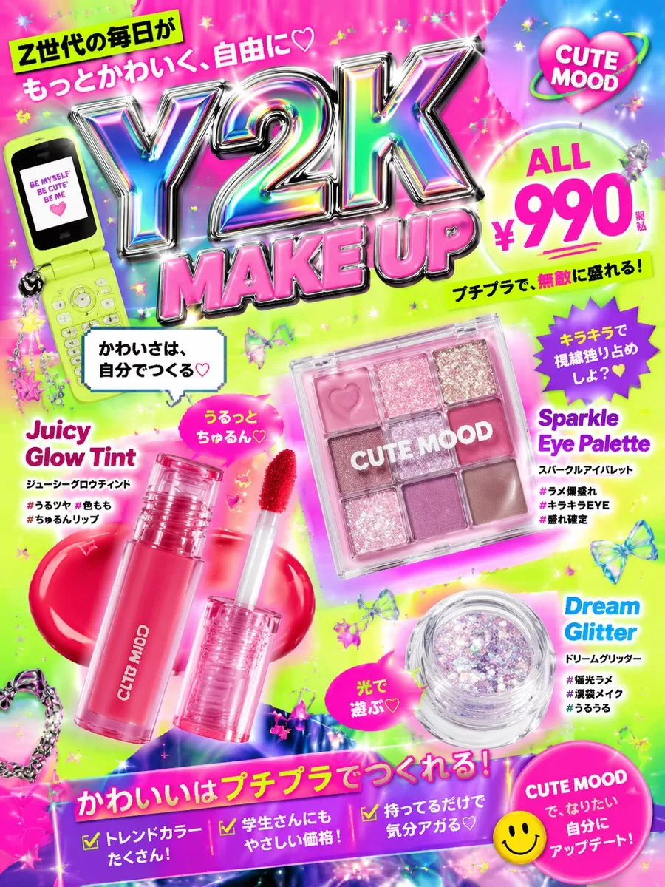

# みどり🐲Midori Tatsuta — by @midori_tatsuta

[← Back to Examples from X](../../EXAMPLES.md) · Category: Poster Design · Model: `GPT Image`

<a href="https://x.com/midori_tatsuta/status/2045378877363798279"></a>

Original post: **[@midori_tatsuta on X](https://x.com/midori_tatsuta/status/2045378877363798279)** · Creator: [みどり🐲Midori Tatsuta](https://x.com/midori_tatsuta)

## Prompt

```text
Cute Y2K style affordable cosmetics advertising image designed for Gen Z. Using vibrant color schemes, including neon colors. Aspect ratio is 3:4.
```

## Try it

Paste the prompt into **[vinano.ai](https://vinano.ai?utm_source=github&utm_medium=readme&utm_campaign=awesome-image-video-prompts-updating&utm_content=x-page-try)** to generate your own version.

> The image and prompt belong to [@midori_tatsuta](https://x.com/midori_tatsuta) and are shown here with credit for reference. Creators can ask for changes or removal by opening an issue.
