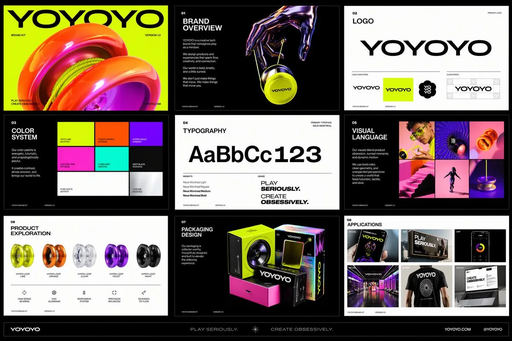

# RIO — by @riomadeit

[← Back to Community Examples](../../EXAMPLES.md) · Category: Product & Brand · Model: `GPT Image`

<a href="https://x.com/riomadeit/status/2046682439985082441"></a>

Source: **[@riomadeit on X](https://x.com/riomadeit/status/2046682439985082441)** · Creator: [RIO](https://x.com/riomadeit)

## Prompt

```text
Create a polished multi-page (multiple images) brand kit for a company called [YOYOYO]. The brand should feel playful, futuristic, vibrant, and design-forward, blending the energy of a toy-inspired product with the sophistication of a premium creative tech brand. Use a bold, experimental visual identity with bright color, clean geometry, modern typography, dynamic motion cues, and slightly surreal imagery. The overall mood should feel inventive, youthful, rhythmic, tactile, and high-concept, with a balance of fun consumer product culture, fashionlike presentation, and contemporary digital design.

Include a sense of product obsession, visual experimentation, packaging exploration, editorial photography, immersive retail, and cross-platform brand application. Make it feel like a confident, contemporary brand world that is both accessible and art-directed, with strong graphic cohesion and a premium creative-studio aesthetic.
```

## Try it

Paste the prompt into **[vinano.ai](https://vinano.ai?utm_source=github&utm_medium=readme&utm_campaign=awesome-image-video-prompts-updating&utm_content=x-page-try)** to generate your own version.

> The image and prompt belong to @riomadeit ([original post](https://x.com/riomadeit/status/2046682439985082441)) and are shown here with credit for reference. Creators can ask for changes or removal by opening an issue.
