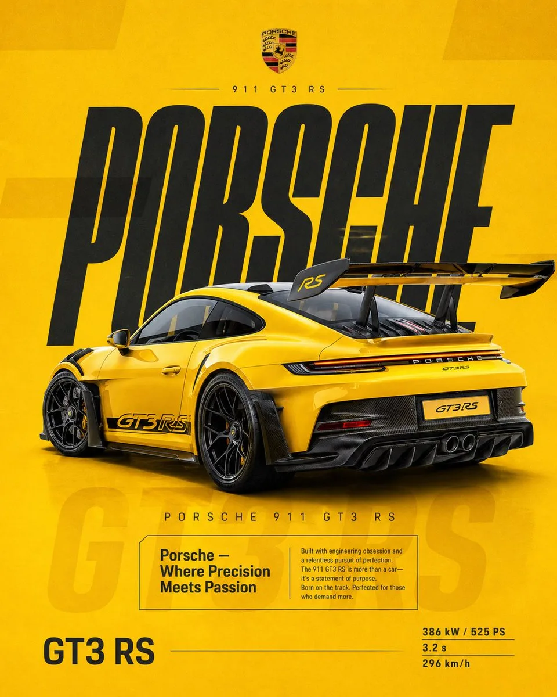

# ᴍᴜʀᴘʜʏ — by @Diplomeme

[← Back to Community Examples](../../EXAMPLES.md) · Category: Poster Design · Model: `GPT Image`

<a href="https://x.com/Diplomeme/status/2047986905896427670"></a>

Source: **[@Diplomeme on X](https://x.com/Diplomeme/status/2047986905896427670)** · Creator: [ᴍᴜʀᴘʜʏ](https://x.com/Diplomeme)

## Prompt

```text
4:5 vertical social poster, ultra high resolution, 8K

SCENE / BACKGROUND:
Flat racing yellow with subtle gradient (light → deep amber)
Grain texture 2–3%
Soft rectangular overlays at 3% opacity

PRODUCT:
Porsche 911 GT3 RS
Gloss yellow with carbon details
Rear 3/4 angle, slightly elevated
Wing dominant

Position:
Right of center

TYPOGRAPHY:
“PORSCHE”
Ultra tall, condensed, stretched
Deep charcoal

Secondary:
“PORSCHE 911 GT3 RS”

EDITORIAL:
“Porsche — Where Precision Meets Passion”

Focus:
engineering, obsession, track DNA

FADED TEXT:
“GT3 RS” at 3–5%

SPECS:
386 kW / 525 PS
3.2 s
296 km/h

LIGHTING:
Clean studio, sharp highlights

MOOD:
Precision.
Iconic.
Timeless performance.

FORMAT:
4:5 vertical social poster, ultra high resolution, 8K, print-quality sharpness

SCENE / BACKGROUND:
Flat, high-saturation BMW blue background

Gradient:
Top → slightly lighter electric blue
Bottom → deep navy blue

Surface:
- Subtle grain texture (2–3%)
- Faint rectangular overlays (2–4% opacity)
- Clean, graphic — no realism

Shadow:
Soft contact shadow under car

PRODUCT (CAR):
BMW M4 CSL

Color:
Matte frozen blue / deep metallic navy

Angle:
Rear 3/4 perspective (IMPORTANT — match Porsche angle for consistency)
Slightly elevated camera

Position:
Slightly right of center

Details:
- Carbon roof visible
- Aggressive diffuser
- Sharp reflections
- Subtle brake detail

COMPOSITION:
IDENTICAL to Porsche:
Top → branding
Middle → giant type
Center → car overlap
Bottom → editorial + specs

TYPOGRAPHY:

PRIMARY:
“BMW”

Style:
Ultra condensed bold sans serif
Tall vertical scaling (same as Porsche)

Color:
Deep navy / near black

Behavior:
Static (NO distortion — unlike previous version)
Acts as structural backdrop

SECONDARY HEADER:
“BMW M4 CSL”
Thin, wide tracking

LOGO AREA:
BMW roundel centered above

EDITORIAL BLOCK:

Headline:
“BMW — Where Driving Becomes Instinct”

Body:
Focus on:
- driver connection
- control
- performance precision

Boxed layout, same structure as Porsche

FADED TEXT:
“CSL” large, 3–5% opacity behind box

BOTTOM LEFT:
“M4 CSL”

BOTTOM RIGHT SPECS:

405 kW / 550 PS
3.4 s
307 km/h

LIGHTING:
Clean studio lighting
Sharp but controlled highlights

COLOR GRADING:
Deep blues, high contrast, clean blacks

CAMERA:
50mm, slightly elevated rear 3/4

MOOD:
Performance.
Precision.
Driver focus.
```

## Try it

Paste the prompt into **[vinano.ai](https://vinano.ai?utm_source=github&utm_medium=readme&utm_campaign=awesome-image-video-prompts-updating&utm_content=x-page-try)** to generate your own version.

> The image and prompt belong to @Diplomeme ([original post](https://x.com/Diplomeme/status/2047986905896427670)) and are shown here with credit for reference. Creators can ask for changes or removal by opening an issue.
