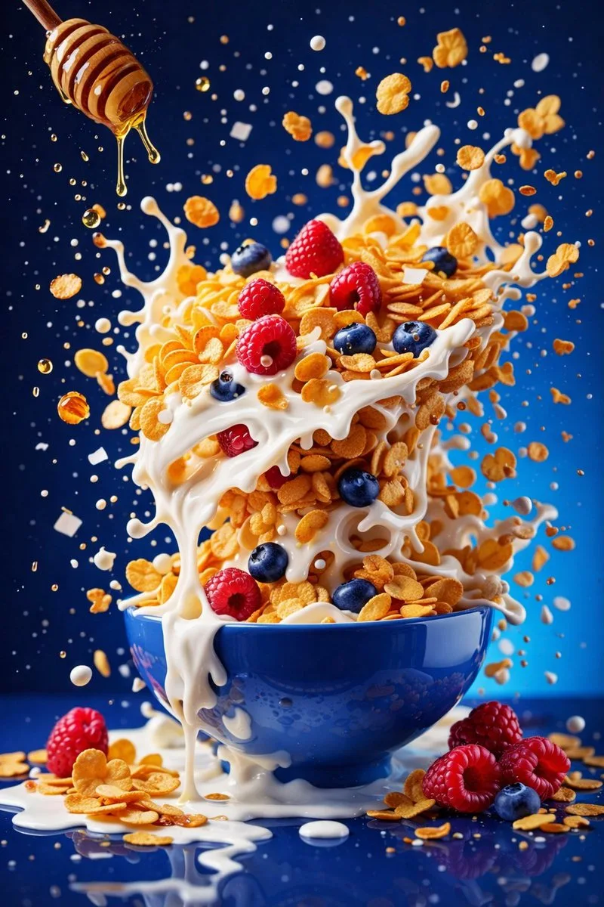

# ShaHid WaNii — by @meng_dagg695

[← Back to Examples from X](../../EXAMPLES.md) · Category: Food & Drink · Model: `GPT Image`

<a href="https://x.com/meng_dagg695/status/2009157208240755151"></a>

Original post: **[@meng_dagg695 on X](https://x.com/meng_dagg695/status/2009157208240755151)** · Creator: [ShaHid WaNii](https://x.com/meng_dagg695)

## Prompt

```text
{
  "resolution": "8K UHD",
  "aspect_ratio": "3:4",
  "image_style": "hyper-realistic commercial food photography",
  "global_settings": {
    "quality": "Ultra-high detail, sharp focus, studio-grade clarity",
    "lighting": "Soft but controlled studio lighting with visible highlights and splash definition",
    "motion": "Frozen mid-air action, ingredients suspended",
    "background_style": "Solid or smooth gradient background, color varies per module",
    "camera": "High-speed photography look, shallow to medium depth of field",
    "post_processing": "Balanced contrast, natural saturation, no artificial glow"
  },

  "modules": {

    "module_1_berry_smoothie_explosion": {
      "scene_description": "A vibrant smoothie bowl exploding with fruit and liquid splashes",
      "bowl": {
        "color": "Deep blue ceramic bowl",
        "finish": "Glossy",
        "position": "Centered, floating mid-air"
      },
      "base_contents": {
        "type": "Thick berry smoothie",
        "color": "Deep purple-magenta",
        "texture": "Creamy with visible swirl marks"
      },
      "ingredients": {
        "fruits": [
          "Banana slices (round, pale yellow)",
          "Blueberries (whole, dark blue)",
          "Raspberries (whole, red)"
        ],
        "herbs": [
          "Fresh mint leaves (bright green)"
        ]
      },
      "motion_effects": {
        "liquid": "Berry smoothie splashing upward and outward",
        "particles": "Small droplets suspended in air"
      },
      "background": {
        "color": "Bright pink",
        "texture": "Smooth, seamless"
      }
    },

    "module_2_minimal_pink_smoothie_bowl": {
      "scene_description": "Minimalist floating smoothie bowl with granola and berries",
      "bowl": {
        "color": "Light pink ceramic bowl with dark speckles",
        "finish": "Matte",
        "position": "Floating centrally"
      },
      "base_contents": {
        "type": "Smoothie",
        "color": "Soft pink with purple undertones",
        "texture": "Thick and smooth"
      },
      "toppings": {
        "granola": "Golden-brown oat clusters",
        "seeds": "Small black seeds scattered",
        "fruits": [
          "Strawberries (halved)",
          "Raspberries (whole)",
          "Blackberries (whole)"
        ]
      },
      "motion_effects": {
        "ingredients": "Granola flakes, seeds, and berries floating gently"
      },
      "background": {
        "color": "Pastel lavender",
        "gradient": "Subtle, soft gradient"
      }
    },

    "module_3_cereal_milk_honey_splash": {
      "scene_description": "Dynamic cereal stack with milk splash and honey drizzle",
      "bowl": {
        "color": "Blue ceramic bowl",
        "finish": "Glossy",
        "position": "Centered, resting visually but surrounded by motion"
      },
      "contents": {
        "cereal": "Golden cornflakes stacked vertically",
        "milk": "White milk splashing and dripping over flakes",
        "fruits": [
          "Raspberries",
          "Blueberries"
        ]
      },
      "additional_elements": {
        "honey": {
          "source": "Wooden honey dipper",
          "state": "Honey dripping mid-air"
        }
      },
      "motion_effects": {
        "splashes": "Milk splashes frozen in dramatic arcs",
        "particles": "Floating flakes and droplets"
      },
      "background": {
        "color": "Deep blue",
        "tone": "High contrast"
      }
    },
}
```

## Try it

Paste the prompt into **[vinano.ai](https://vinano.ai?utm_source=github&utm_medium=readme&utm_campaign=awesome-image-video-prompts-updating&utm_content=x-page-try)** to generate your own version.

> The image and prompt belong to [@meng_dagg695](https://x.com/meng_dagg695) and are shown here with credit for reference. Creators can ask for changes or removal by opening an issue.
