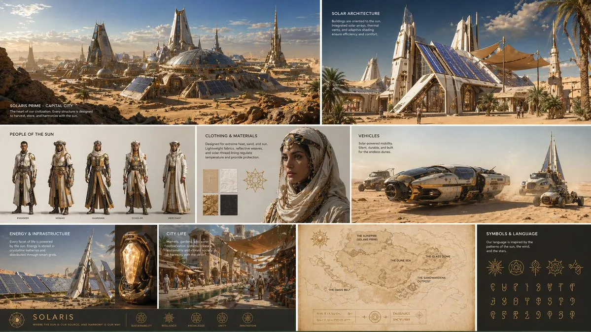

# Aleena Amir — by @aleenaamiir

[← Back to Community Examples](../../EXAMPLES.md) · Category: Poster Design · Model: `GPT Image`

<a href="https://x.com/aleenaamiir/status/2046866168208916503"></a>

Source: **[@aleenaamiir on X](https://x.com/aleenaamiir/status/2046866168208916503)** · Creator: [Aleena Amir](https://x.com/aleenaamiir)

## Prompt

```text
Create a complete visual worldbuilding set for a futuristic desert civilization powered by solar technology, multiple images including architecture, characters, clothing, vehicles, and maps, cohesive design language, cinematic realism, ultra detailed.
```

## Try it

Paste the prompt into **[vinano.ai](https://vinano.ai?utm_source=github&utm_medium=readme&utm_campaign=awesome-image-video-prompts-updating&utm_content=x-page-try)** to generate your own version.

> The image and prompt belong to @aleenaamiir ([original post](https://x.com/aleenaamiir/status/2046866168208916503)) and are shown here with credit for reference. Creators can ask for changes or removal by opening an issue.
