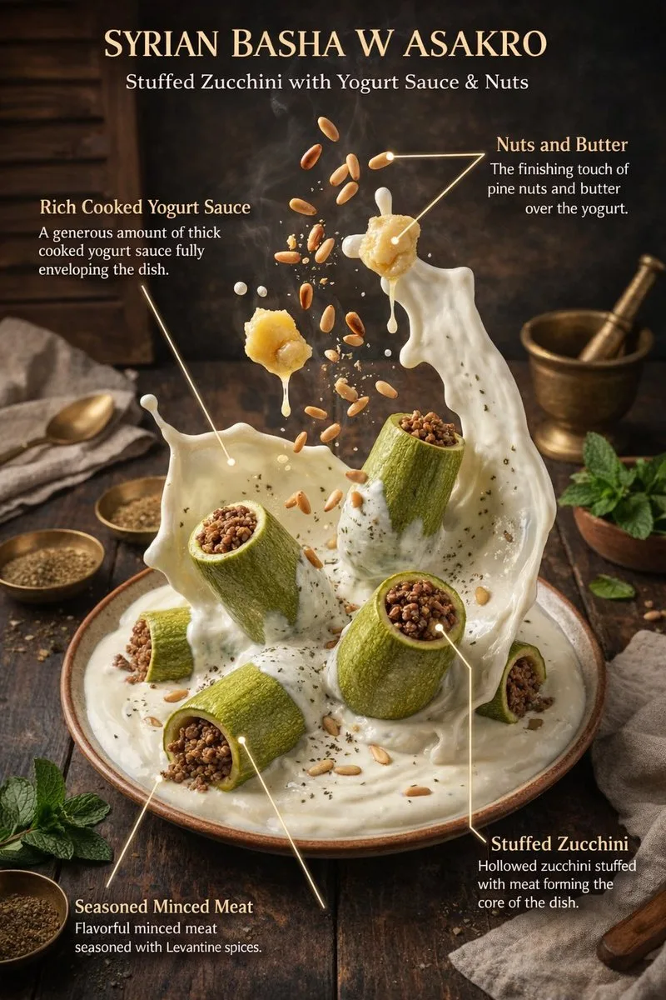

# ShaHid WaNii — by @meng_dagg695

[← Back to Community Examples](../../EXAMPLES.md) · Category: Food & Drink · Model: `GPT Image`

<a href="https://x.com/meng_dagg695/status/2011994819124752631"></a>

Source: **[@meng_dagg695 on X](https://x.com/meng_dagg695/status/2011994819124752631)** · Creator: [ShaHid WaNii](https://x.com/meng_dagg695)

## Prompt

```text
{
  "global_settings": {
    "resolution": "8K ultra high definition",
    "aspect_ratio": "3:4",
    "camera_style": "studio food photography with cinematic lighting",
    "depth_of_field": "shallow depth of field, sharp subject, soft background",
    "lighting": "soft directional key light, subtle rim light, controlled highlights",
    "style": "hyper-realistic food illustration with editorial infographic overlays",
    "composition_rules": [
      "no zoom",
      "no crop",
      "center-weighted vertical composition",
      "floating elements frozen in motion"
    ],
    "text_design": {
      "ingredient_name_color": "metallic gold",
      "ingredient_description_color": "pure white",
      "font_style": "elegant serif for titles, clean sans-serif for descriptions",
      "indicator_lines": "long, thin, smooth golden lines with rounded corners"
    }
  },

  "module_1_image_1_style": {
    "scene_description": "A vertical stack of assorted cake slices floating above a white ceramic plate against a soft pink gradient background.",
    "background": {
      "color": "soft pastel pink",
      "texture": "smooth gradient",
      "lighting": "even, studio-lit, no harsh shadows"
    },
    "main_subjects": [
      "multiple layered sponge cake slices",
      "white whipped cream layers",
      "raspberry cream layer",
      "chocolate cream topping"
    ],
    "visible_ingredients": [
      "vanilla sponge cake",
      "whipped cream",
      "raspberries",
      "blueberries",
      "strawberries",
      "macarons (vanilla and chocolate)",
      "chocolate bar pieces",
      "mint leaves",
      "small nut fragments"
    ],
    "motion_elements": [
      "floating fruits",
      "floating macarons",
      "crumbs suspended in air"
    ],
    "text_labels": [
      "Vanilla Cake – soft, fluffy sponge cake layered with white cream filling",
      "Macaron – creamy filling between almond meringue shells",
      "Raspberries – juicy, fresh raspberries",
      "Chocolate Bar – chunks of smooth milk chocolate",
      "Raspberry Cream – soft sponge cake layered with creamy, fruity raspberry cream"
    ]
  },

  "module_2_image_2_style": {
    "scene_description": "Rolled Syrian dessert presented vertically with syrup pouring from above, placed in a warm, rustic kitchen environment.",
    "background": {
      "environment": "traditional kitchen",
      "elements": [
        "warm lantern light",
        "wooden surfaces",
        "brass and copper utensils"
      ],
      "lighting": "warm ambient lighting with soft highlights"
    },
    "main_subjects": [
      "rolled white dessert dough",
      "cream filling spilling out",
      "golden syrup stream"
    ],
    "visible_ingredients": [
      "white cheese dough",
      "cream filling",
      "pistachios",
      "sugar syrup"
    ],
    "motion_elements": [
      "syrup dripping vertically",
      "pistachio crumbs falling"
    ],
    "text_labels": [
      "White Cheese Dough – soft outer layer made from cheese and semolina",
      "Cream Filling – creamy filling inside the roll",
      "Pistachios – crushed pistachios sprinkled over and inside the rolls"
    ]
  }
```

## Try it

Paste the prompt into **[vinano.ai](https://vinano.ai?utm_source=github&utm_medium=readme&utm_campaign=awesome-image-video-prompts-updating&utm_content=x-page-try)** to generate your own version.

> The image and prompt belong to @meng_dagg695 ([original post](https://x.com/meng_dagg695/status/2011994819124752631)) and are shown here with credit for reference. Creators can ask for changes or removal by opening an issue.
