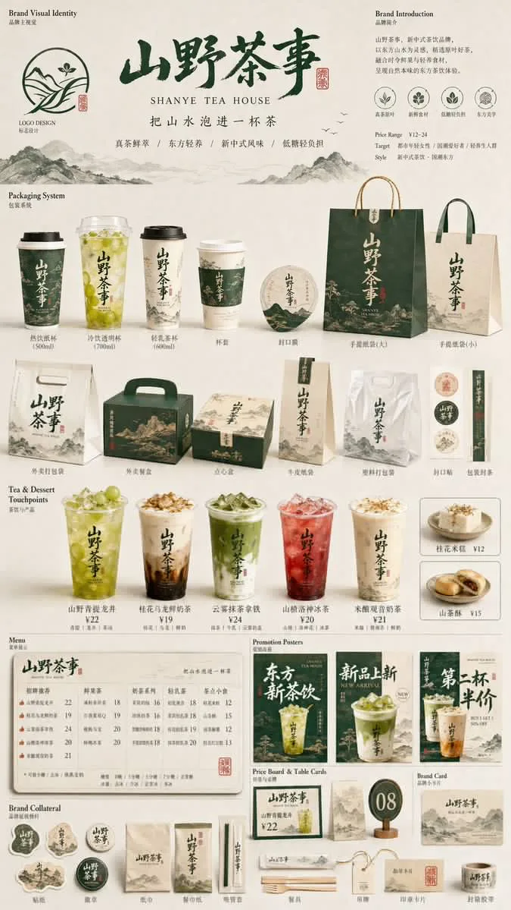

# Larus Canus — by @MrLarus

[← Back to Community Examples](../../EXAMPLES.md) · Category: Poster Design · Model: `GPT Image`

<a href="https://x.com/MrLarus/status/2048360321379701233"></a>

Source: **[@MrLarus on X](https://x.com/MrLarus/status/2048360321379701233)** · Creator: [Larus Canus](https://x.com/MrLarus)

## Prompt

```text
生成一张[餐饮品牌触点矩阵]系列视觉图，用于展示一个完整的餐饮品牌视觉系统与包装应用方案。

这是一个面向餐饮行业的品牌VI样机展示板 / 包装系统陈列图 / 品牌提案页。画面不是单张宣传海报，而是将品牌主视觉、主打产品、包装物料、菜单信息、促销内容与小型延展物料整合成一张系统化品牌展示图。

【用户输入信息】
- 品牌名：[品牌名]
- 经营类目：[经营类目]

【可选补充信息】
- 主打产品：[主打产品]
- 品牌口号：[品牌口号]
- 风格方向：[风格方向]
- 主色调：[主色调]
- 辅助色：[辅助色]
- 客群定位：[客群定位]
- 价格定位：[价格定位]
- 地域风格：[地域风格]
- 画幅比例：[画幅比例]

【自动补全规则】
如果用户没有提供完整品牌信息，请根据【品牌名】与【经营类目】自动推导并完成最优组合，包括：
1. 判断品牌调性（年轻、亲和、国潮、复古、清新、治愈、精致、快餐感等）
2. 匹配适合该类目的视觉风格
3. 自动设定合理的主色、辅助色与点缀色
4. 自动补全主打产品与辅助产品
5. 自动生成适合餐饮传播的品牌口号、卖点文案、价格信息与推荐标签
6. 自动匹配合适的餐饮物料类型与展示内容

【画面内容要求】
画面中应围绕【品牌名】构建一整套餐饮品牌物料系统，包含但不限于以下内容：
- 核心包装：手提袋、外卖袋、包装盒、打包盒、纸袋、塑料袋
- 饮品 / 食品容器：纸杯、杯套、碗、餐盒、封口贴、标签
- 信息传播物料：菜单、促销海报、价格牌、桌牌、立牌、小卡片
- 小型品牌延展：贴纸、徽章、纸巾、餐具、包装封条、吊牌
- 产品表现：主打餐品照片、单品主视觉、食物特写、切面图、推荐组合图

【构图与版式要求】
采用竖版【画幅比例】构图，整体为白色、米白色或浅灰色背景，以品牌提案板 / 样机矩阵板的方式组织画面。
通过大中小物料混排形成视觉层级：
- 大型包装和主视觉物料作为视觉锚点
- 中型菜单、海报和价格模块负责信息传达
- 小型贴纸、餐具、标签与周边物料增强系统完整度

整体构图应具有明确秩序感，接近品牌方案展示页、作品集陈列页、包装提案页的视觉效果。元素要排列整齐但不呆板，丰富但不杂乱，具有模块化与可阅读性。

【风格与质感要求】
整体风格应符合【经营类目】与【品牌名】气质，具有明显的餐饮品牌感、商业传播感、样机展示感与系统设计感。
可融合以下风格倾向：现代简洁、国潮趣味、轻复古、生活方式感、快消感、温暖治愈感、年轻化传播感。
材质真实，包含纸张、塑料、布袋、包装盒、杯体、贴纸、餐具等真实物料质感；光影柔和统一，像在干净摄影棚环境中拍摄的品牌物料合集。

【文字与图形要求】
所有物料上应统一出现品牌名、Logo、品牌符号、主色块、口号或卖点文案。
文案可为中文或中英混排，但要符合餐饮传播表达，简洁直接，具备商品售卖感。
图形系统可以根据品牌调性选择简洁插画、几何图形、卡通吉祥物、符号化图标或辅助纹样，用于增强品牌记忆点。

【输出目标】
最终生成一张完整的【品牌名】餐饮品牌视觉系统展示图，像设计团队为该餐饮品牌制作的整套品牌提案样机板。
要求画面统一、精致、具备商业落地感与作品集展示质量，并能清楚体现品牌风格、主打类目与多触点包装延展能力。

Make the aspect ratio 9:16
```

## Try it

Paste the prompt into **[vinano.ai](https://vinano.ai?utm_source=github&utm_medium=readme&utm_campaign=awesome-image-video-prompts-updating&utm_content=x-page-try)** to generate your own version.

> The image and prompt belong to @MrLarus ([original post](https://x.com/MrLarus/status/2048360321379701233)) and are shown here with credit for reference. Creators can ask for changes or removal by opening an issue.
