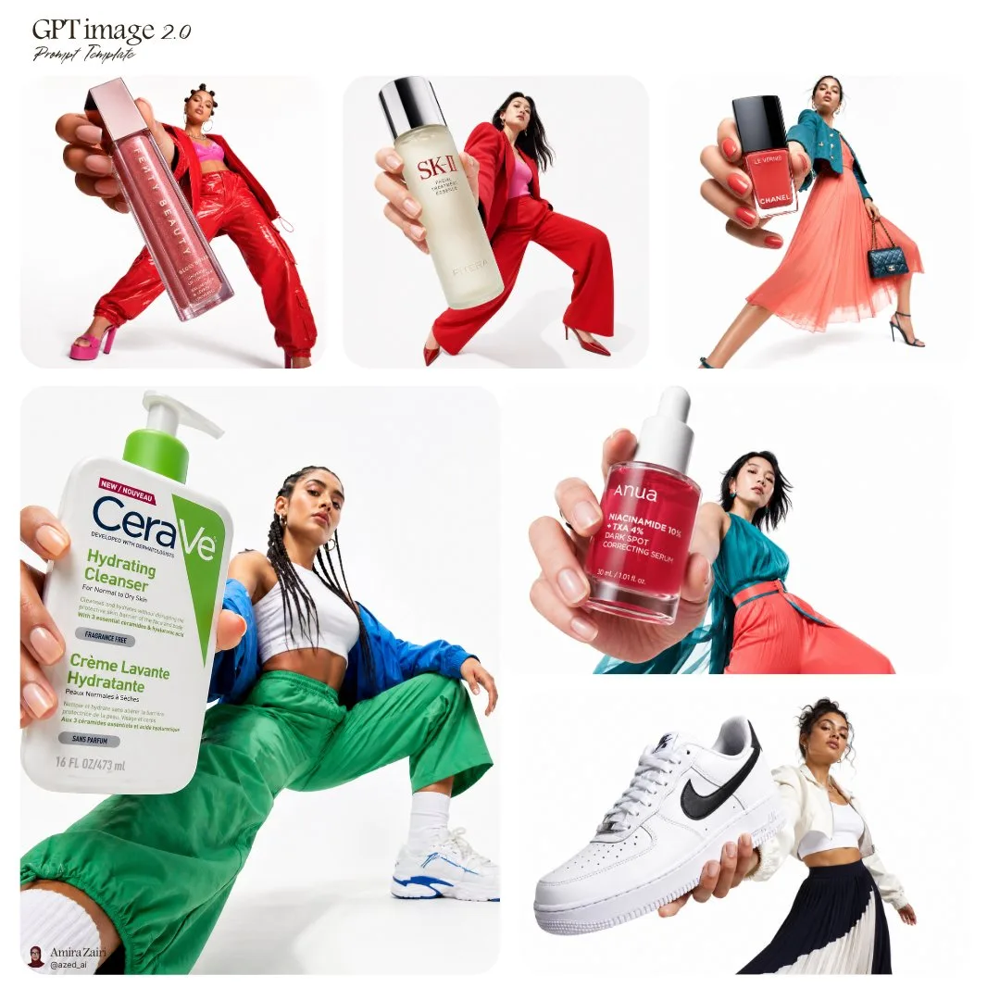

# Amira Zairi — by @azed_ai

[← Back to Community Examples](../../EXAMPLES.md) · Category: Poster Design · Model: `GPT Image`

<a href="https://x.com/azed_ai/status/2048748266293190833"></a>

Source: **[@azed_ai on X](https://x.com/azed_ai/status/2048748266293190833)** · Creator: [Amira Zairi](https://x.com/azed_ai)

## Prompt

```text
Low-angle fashion campaign photograph of a confident model holding a large [product name] very close to the camera, exaggerated perspective with the hand and product dominating the foreground, full-body pose visible in the background, wide stance, dynamic posture, clean pure white studio background, high-key lighting, sharp focus on product, slight depth of field on the model, bold colorful outfit with strong contrast tones, modern beauty advertising aesthetic, ultra-clean composition, commercial studio photography, glossy packaging detail visible, crisp shadows
```

## Try it

Paste the prompt into **[vinano.ai](https://vinano.ai?utm_source=github&utm_medium=readme&utm_campaign=awesome-image-video-prompts-updating&utm_content=x-page-try)** to generate your own version.

> The image and prompt belong to @azed_ai ([original post](https://x.com/azed_ai/status/2048748266293190833)) and are shown here with credit for reference. Creators can ask for changes or removal by opening an issue.
