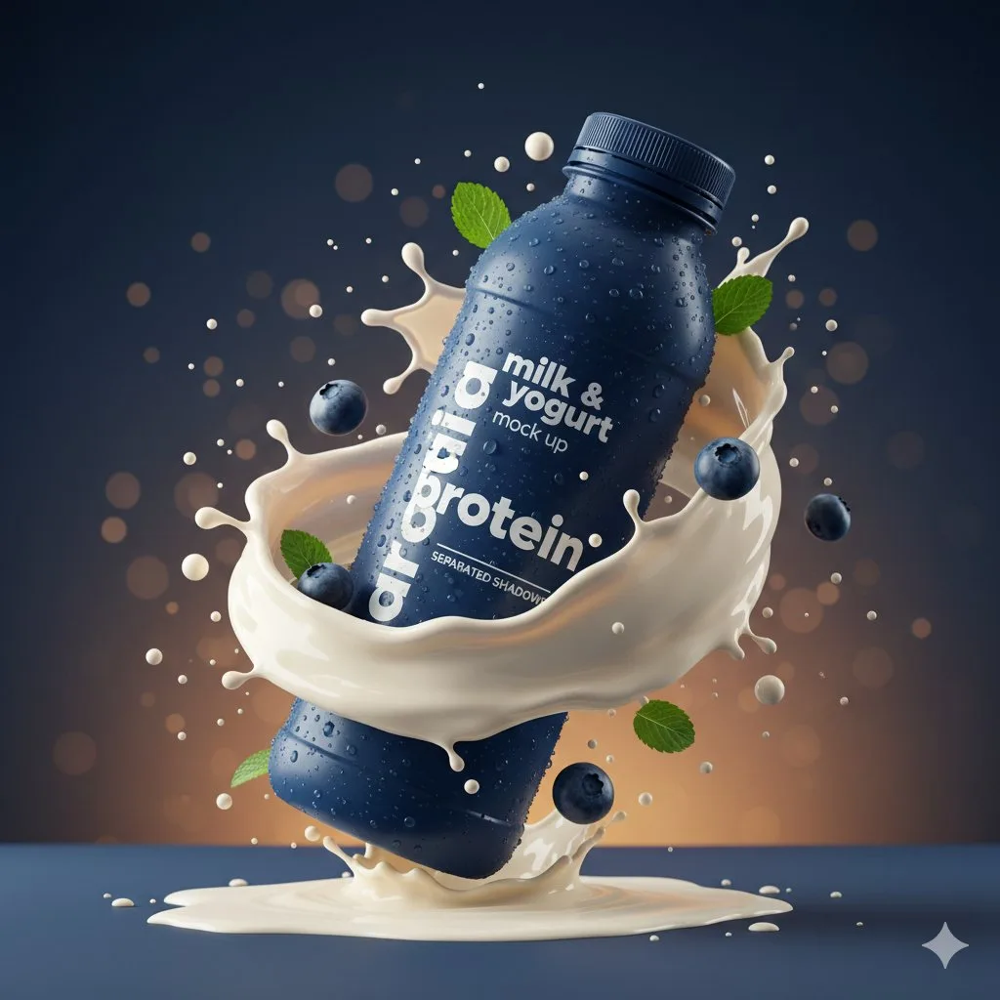

# Meem — by @mehvishs25

[← Back to Community Examples](../../EXAMPLES.md) · Category: Product & Brand · Model: `GPT Image`

<a href="https://x.com/mehvishs25/status/2017420332458774791"></a>

Source: **[@mehvishs25 on X](https://x.com/mehvishs25/status/2017420332458774791)** · Creator: [Meem](https://x.com/mehvishs25)

## Prompt

```text
{
  "master_prompt": {
    "global_settings": {
      "resolution": "8K ultra-high-definition",
      "aspect_ratio": "3:4 vertical",
      "style": "hyper-realistic AI-edited commercial product photography",
      "sharpness": "extreme clarity, micro-detail visibility",
      "lighting_quality": "cinematic studio lighting with controlled highlights and shadows",
      "motion_freeze": "high-speed capture, frozen splashes and particles",
      "noise": "none",
      "artifacts": "none"
    },

"module_1_image_1_style": {
      "subject": {
        "type": "plastic protein drink bottle",
        "color": "deep matte blue",
        "surface_details": "condensation droplets across entire bottle",
        "label_text_visible": [
          "milk & yogurt",
          "mock up",
          "protein",
          "SEPARATED SHADOWS"
        ]
      },
      "pose_and_orientation": {
        "position": "slightly tilted to the right",
        "angle": "three-quarter view",
        "motion_feel": "dynamic, leaning into splash"
      },
      "liquid_and_motion": {
        "liquid_color": "white and light beige milk mixture",
        "texture": "smooth, creamy, fluid",
        "motion": "swirling splash rising around bottle base and sides"
      },
      "floating_elements": {
        "blueberries": "whole and halved blueberries at different depths",
        "mint_leaves": "small green leaves with visible veins",
        "droplets": "milk droplets and spheres suspended mid-air"
      },
      "background": {
        "color_gradient": "dark blue to warm amber",
        "bokeh": "soft circular light particles scattered throughout"
      },
      "surface_and_reflection": {
        "base": "matte ground with light liquid pooling",
        "shadow_style": "soft separated shadow under bottle"
      }
    },
"module_2_image_2_style": {
      "subject": {
        "type": "metal coffee can",
        "color": "warm gold",
        "surface_details": "heavy condensation with visible droplets",
        "branding_text_visible": [
          "NESCAFÉ",
          "Latte",
          "NEW LOOK",
          "ICED COFFEE WITH MILK",
          "SUGAR AND SWEETENER OPTIONAL"
        ]
      },
      "pose_and_orientation": {
        "position": "upright, centered",
        "angle": "front-facing",
        "presence": "hero product stance"
      },
      "liquid_and_motion": {
        "liquid_color": "coffee and milk blend",
        "motion": "splash erupting from base",
        "droplet_behavior": "fine droplets scattered outward"
      },
      "floating_elements": {
        "coffee_beans": "whole roasted beans floating around can",
        "steam": "thick swirling steam rising upward",
        "embers": "tiny glowing particles in background"
      },
      "background": {
        "color_palette": "deep brown, amber, gold",
        "atmosphere": "warm, smoky, intense"
      },
      "surface_and_reflection": {
        "base": "wet surface with liquid splash crown",
        "reflection_quality": "subtle reflective highlights"
      }
    }
```

## Try it

Paste the prompt into **[vinano.ai](https://vinano.ai?utm_source=github&utm_medium=readme&utm_campaign=awesome-image-video-prompts-updating&utm_content=x-page-try)** to generate your own version.

> The image and prompt belong to @mehvishs25 ([original post](https://x.com/mehvishs25/status/2017420332458774791)) and are shown here with credit for reference. Creators can ask for changes or removal by opening an issue.
