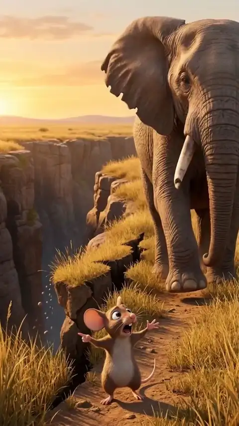

# Elephant and Mouse Cliff Friendship — by @ZarnishNael

[← Back to Community Examples](../../EXAMPLES.md) · Category: Video · Model: `Seedance 2.0`

<a href="https://x.com/ZarnishNael/status/2122919421635121290"></a>

**[▶ Watch the full video on X](https://x.com/ZarnishNael/status/2122919421635121290)** — the preview above is a short silent clip.

Source: **[@ZarnishNael on X](https://x.com/ZarnishNael/status/2122919421635121290)** · Creator: [Zarnish](https://x.com/ZarnishNael)

## Prompt

```text
A heartwarming and funny cinematic 3D animated scene of a giant baby elephant and a tiny adorable mouse standing on a narrow grassy cliff edge in the African savanna during golden hour. The elephant looks curiously at the little mouse while the mouse waves its tiny hands and acts scared. The elephant gently uses its trunk to pick up a small bunch of grass and interacts playfully with the mouse. Suddenly, the mouse gets lifted by the elephant's trunk and lands safely on the elephant's head. The mouse happily sits on top while the elephant walks forward peacefully. Beautiful orange sunset, dramatic canyon landscape, realistic grass, floating dust particles, expressive cute characters, detailed elephant skin, Pixar-quality 3D animation, cinematic camera movements, smooth character animation, emotional storytelling, warm lighting, ultra-detailed textures, 4K quality, vertical 9:16.
```

## Try it

Paste the prompt into **[vinano.ai](https://vinano.ai?utm_source=github&utm_medium=readme&utm_campaign=awesome-image-video-prompts-updating&utm_content=x-page-try)** to generate your own version.

> The video and prompt belong to @ZarnishNael ([original post](https://x.com/ZarnishNael/status/2122919421635121290)) and are shown here with credit for reference. Creators can ask for changes or removal by opening an issue.
