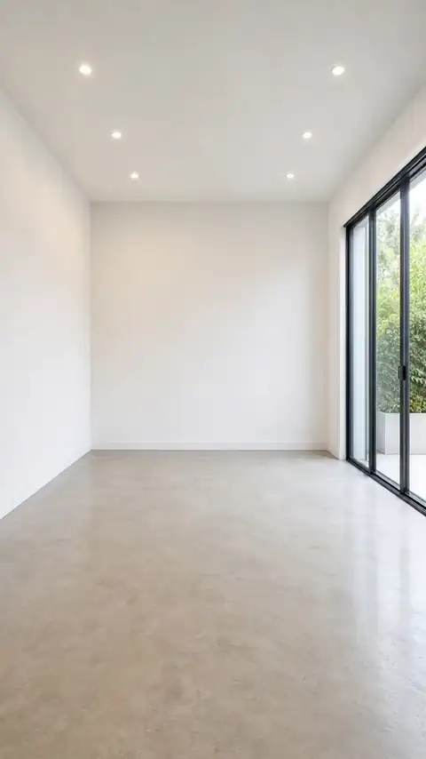

# Roses Into a Bedroom Floor — by @Ruslanchain

[← Back to Community Examples](../../EXAMPLES.md) · Category: Video · Model: `Seedance 2.0`

<a href="https://x.com/Ruslanchain/status/2119093181585179086"></a>

**[▶ Watch the full video on X](https://x.com/Ruslanchain/status/2119093181585179086)** — the preview above is a short silent clip.

Source: **[@Ruslanchain on X](https://x.com/Ruslanchain/status/2119093181585179086)** · Creator: [Ruslan Ai](https://x.com/Ruslanchain)

## Prompt

```text
A fast-motion timelapse inside an empty modern room with white walls, polished concrete floor, recessed ceiling lights and a large glass sliding door overlooking greenery. Two workers in blue shirts carry huge buckets of red roses, dump them in the center, and quickly spread thousands of roses and petals evenly across the entire floor. Workers in white hazmat suits and respirators pour milky white liquid epoxy resin over the roses, spreading it with brooms and squeegees until the flowers are fully coated and flattened. A team in gray uniforms operates rotary floor polishers, buffing the surface in circular patterns until the resin cures into a glossy, mirror-like floor with red roses permanently embedded beneath a crystal-clear finish, reflecting the lights. One worker kneels polishing edges by hand while others stand proudly with their machines. The scene then transitions to furnishing: workers assemble a beige upholstered bed frame, add a red rose-patterned duvet and pillows, place matching nightstands with red rose lamps, hang red rose curtains and a large framed red rose painting above the headboard. Final cinematic reveal: a stunning romantic bedroom where the entire floor is a glossy red rose epoxy artwork, soft warm lighting, reflections gleaming on the rose floor, camera slowly panning across the finished luxurious space. Photorealistic, high detail, smooth timelapse transitions, vertical 9:16 format.
```

## Try it

Paste the prompt into **[vinano.ai](https://vinano.ai?utm_source=github&utm_medium=readme&utm_campaign=awesome-image-video-prompts-updating&utm_content=x-page-try)** to generate your own version.

> The video and prompt belong to @Ruslanchain ([original post](https://x.com/Ruslanchain/status/2119093181585179086)) and are shown here with credit for reference. Creators can ask for changes or removal by opening an issue.
