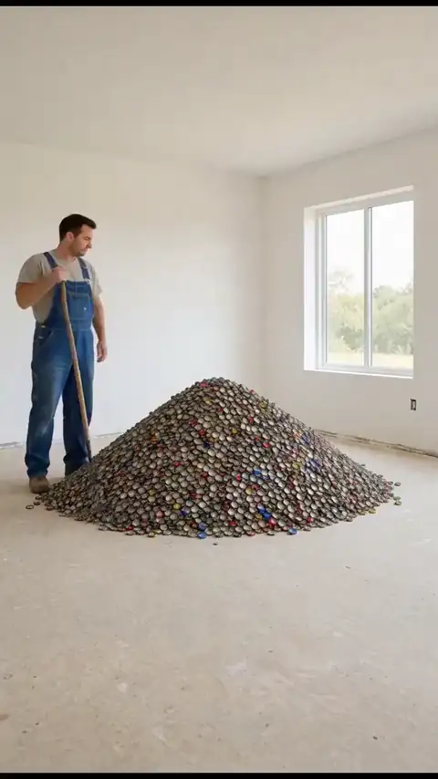

# Bottle Caps Into a Floor — by @Rajrana12476547

[← Back to Community Examples](../../EXAMPLES.md) · Category: Video · Model: `Seedance 2.0`

<a href="https://x.com/Rajrana12476547/status/2119092317059481917"></a>

**[▶ Watch the full video on X](https://x.com/Rajrana12476547/status/2119092317059481917)** — the preview above is a short silent clip.

Source: **[@Rajrana12476547 on X](https://x.com/Rajrana12476547/status/2119092317059481917)** · Creator: [Linh Ai](https://x.com/Rajrana12476547)

## Prompt

```text
Vertical satisfying renovation video in a bright empty room with white walls and a sunlit window. A man in denim overalls rakes an enormous pile of thousands of colorful metal bottle caps, spreading them into a perfectly even layer covering the entire floor, with close-up shots revealing a dense mosaic of red, blue, yellow and green caps. A woman in red overalls tilts a large bucket, pouring thick creamy white self-leveling epoxy that flows smoothly across the caps and settles, leaving only the colorful tops peeking through like polka dots. A worker in a yellow hi-vis vest glides a rotary floor buffer with a vacuum hose over the cured surface, polishing it to a mirror gloss. Two men in black assemble a light wooden bed frame on the new floor, set a mattress on it, spread a crisp white duvet and arrange white pillows, then step away. Final beauty shot of the finished minimalist bedroom, glossy white floor scattered with vivid bottle cap dots, soft natural daylight, smooth camera movement, realistic textures and details, satisfying ASMR makeover timelapse style.
```

## Try it

Paste the prompt into **[vinano.ai](https://vinano.ai?utm_source=github&utm_medium=readme&utm_campaign=awesome-image-video-prompts-updating&utm_content=x-page-try)** to generate your own version.

> The video and prompt belong to @Rajrana12476547 ([original post](https://x.com/Rajrana12476547/status/2119092317059481917)) and are shown here with credit for reference. Creators can ask for changes or removal by opening an issue.
