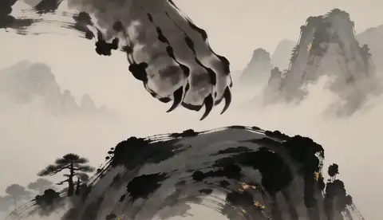

# The Ink Tiger — by @AllaAisling

[← Back to Community Examples](../../EXAMPLES.md) · Category: Video · Model: `Seedance 2.0`

<a href="https://x.com/AllaAisling/status/2118872216741749097"></a>

**[▶ Watch the full video on X](https://x.com/AllaAisling/status/2118872216741749097)** — the preview above is a short silent clip.

Source: **[@AllaAisling on X](https://x.com/AllaAisling/status/2118872216741749097)** · Creator: [Alexandra Aisling](https://x.com/AllaAisling)

## Prompt

```text
Animated East Asian ink wash painting, expressive brushstroke motion, ink bleeding and spreading into paper, rice paper texture, misty negative space, powerful yet calm movement. Color grade: ink black, soft grays, warm paper, faint gold eyes, one vermilion seal stamp.  
A colossal tiger made of flowing ink and mist, its stripes formed by bold dry brush strokes. A scholar with an umbrella on a rope bridge among bamboo forests.  
SHOT 1 (0 to 3s): Wide shot, the tiger's paw lands on a peak and ink spreads outward like a shockwave through the mist.  
SHOT 2 (3 to 6s): Medium shot, 35mm lens, the scholar on the rope bridge grips the rails as the bridge sways, bamboo bending all around.  
SHOT 3 (6 to 9s): Close-up, 85mm lens, the tiger's face forms out of swirling ink, its gold eyes opening, whiskers painted in quick sharp strokes.  
SHOT 4 (9 to 12s): Low angle wide shot, 20mm lens, the tiger leaps over the valley, its body stretching into long brushstrokes, ink droplets falling like rain.  
SHOT 5 (12 to 15s): Extreme wide shot, 16mm lens, the tiger lands on a distant mountain and dissolves into mist, leaving only its ink pawprints, as a vermilion seal stamps the corner of the frame.  
Mountain wind, creaking rope bridge, rustling bamboo, a brush sweeping across paper, a deep resonant roar that echoes through the valley, erhu and guqin, a final soft stamp sound.
```

## Try it

Paste the prompt into **[vinano.ai](https://vinano.ai?utm_source=github&utm_medium=readme&utm_campaign=awesome-image-video-prompts-updating&utm_content=x-page-try)** to generate your own version.

> The video and prompt belong to @AllaAisling ([original post](https://x.com/AllaAisling/status/2118872216741749097)) and are shown here with credit for reference. Creators can ask for changes or removal by opening an issue.
