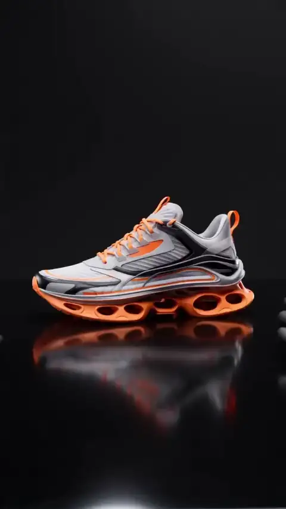

# Exploding Futuristic Sneaker — by @ZarnishNael

[← Back to Community Examples](../../EXAMPLES.md) · Category: Video · Model: `Seedance 2.0`

<a href="https://x.com/ZarnishNael/status/2118559810035593407"></a>

**[▶ Watch the full video on X](https://x.com/ZarnishNael/status/2118559810035593407)** — the preview above is a short silent clip.

Source: **[@ZarnishNael on X](https://x.com/ZarnishNael/status/2118559810035593407)** · Creator: [Zarnish](https://x.com/ZarnishNael)

## Prompt

```text
A premium futuristic sneaker floats in a dark minimalist studio with dramatic spotlighting and a glossy reflective black floor. The shoe slowly separates into multiple individual layers, revealing its advanced internal construction: a sleek upper mesh, black cushioning layer, white midsole, and bright orange futuristic honeycomb-inspired sole.
The camera smoothly moves closer as each component floats separately in perfect alignment, showcasing the intricate engineering and innovative design.
Cut to extreme macro close-ups of the orange sole's unique hollow cushioning structure, detailed stitching, breathable mesh, and premium materials. Black-gloved hands carefully hold and demonstrate the flexible sole, highlighting its innovative shock-absorbing technology.
Next, show hands assembling the sneaker layer by layer with precise mechanical movements. Finish with the fully assembled sneaker floating elegantly in the center of the dark studio, rotating slowly under dramatic cinematic lighting.
```

## Try it

Paste the prompt into **[vinano.ai](https://vinano.ai?utm_source=github&utm_medium=readme&utm_campaign=awesome-image-video-prompts-updating&utm_content=x-page-try)** to generate your own version.

> The video and prompt belong to @ZarnishNael ([original post](https://x.com/ZarnishNael/status/2118559810035593407)) and are shown here with credit for reference. Creators can ask for changes or removal by opening an issue.
