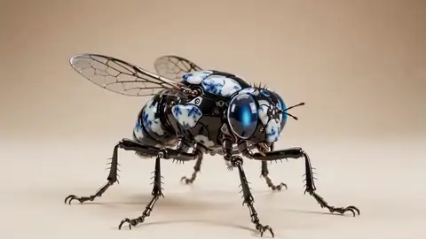

# Engineered Mechanical Fly — by @sebatheepan

[← Back to Community Examples](../../EXAMPLES.md) · Category: Video · Model: `Seedance 2.0`

<a href="https://x.com/sebatheepan/status/2118360399057756590"></a>

**[▶ Watch the full video on X](https://x.com/sebatheepan/status/2118360399057756590)** — the preview above is a short silent clip.

Source: **[@sebatheepan on X](https://x.com/sebatheepan/status/2118360399057756590)** · Creator: [Pan](https://x.com/sebatheepan)

## Prompt

```text
Macro cinematic push-in on a cyberpunk mechanical fly, beginning as a clean product-style beauty shot, then transitioning into an invasive, surgical exploration of its internal clockwork systems.

Scene: Minimal studio environment with a soft beige seamless backdrop. High-end product lighting, controlled reflections, and subtle rim highlights outline a hyper-detailed cyberpunk mechanical fly. The atmosphere is clean, sterile, and quiet—like a futuristic lab or design showcase.

Subject: A robotic fly with a hybrid aesthetic: glossy black chrome exoskeleton fused with delicate blue-and-white porcelain shell segments. Its compound eyes glow with soft blue internal light. Fine metallic legs articulate with precision, and translucent mechanical wings vibrate subtly with micro-movements.

Action: The fly remains mostly still, performing subtle lifelike micro-adjustments—legs twitching, head tilting slightly, wings softly vibrating. A slow, deliberate push-in moves toward its head and thorax. As the camera approaches, the outer shell separates and peels back in layered mechanical sections, revealing intricate inner systems. The camera continues forward through the opening, transitioning seamlessly from exterior to interior. Inside, interlocking gears, spinning gyros, pulsing micro-pistons, rotating rings, and glowing blue energy cores operate in synchronized motion. Tiny components click, rotate, and shift in precise mechanical choreography as the camera navigates deeper into the machine’s core.

Audio: Soft mechanical ambience with high-frequency servo whirs, micro-clicks, and delicate ticking. A subtle electric hum builds as the camera enters the interior. Layered clockwork rhythm—interlocking ticks, spinning mechanisms, and faint hydraulic pulses—becomes increasingly immersive and almost musical.

Tone: Clinical, mesmerising, hypnotic. Engineered beauty and hidden complexity. Slow, controlled pacing focused on discovery and precision. The surface-to-interior transition should feel seamless, like entering another world within the machine.

Camera: Start with a 100mm macro feel for shallow depth and product-style compression, then transition into an impossible probe-lens perspective inside the mechanism. Ultra-smooth slow push-in, no handheld movement. Micro focus pulls as each layer reveals. Slight parallax shift inside to enhance depth.
```

## Try it

Paste the prompt into **[vinano.ai](https://vinano.ai?utm_source=github&utm_medium=readme&utm_campaign=awesome-image-video-prompts-updating&utm_content=x-page-try)** to generate your own version.

> The video and prompt belong to @sebatheepan ([original post](https://x.com/sebatheepan/status/2118360399057756590)) and are shown here with credit for reference. Creators can ask for changes or removal by opening an issue.
