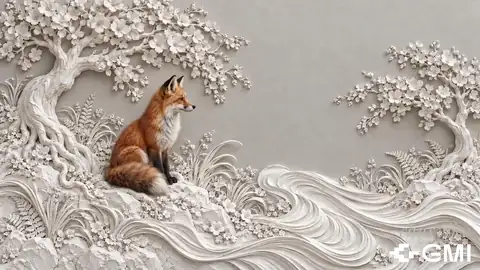

# Paper-Cut Autumn Awakening — by @churvikv

[← Back to Community Examples](../../EXAMPLES.md) · Category: Video · Model: `Seedance 2.0`

<a href="https://x.com/churvikv/status/2118324800305111137"></a>

**[▶ Watch the full video on X](https://x.com/churvikv/status/2118324800305111137)** — the preview above is a short silent clip.

Source: **[@churvikv on X](https://x.com/churvikv/status/2118324800305111137)** · Creator: [Viki](https://x.com/churvikv)

## Prompt

```text
3D paper cut art style, layered paper sculpture aesthetic, volumetric cotton-wool and felted-fibre texture with soft fluffy wisps along every cut edge. Ivory-white sculpted relief world: a large blossom-covered paper tree at the upper left, a small sculpted blossom tree at the right edge, carved paper waves flowing across the foreground, scattered paper flowers and pale rocks, all in cream and pale grey. A single red fox sits on a white paper rock at the left of the frame. The fox lifts its head, rises onto its paws and begins to walk to the right along the sculpted ledge. The instant its first paw touches the paper ground, warm golden light ignites beneath the paws and bursts outward as a smooth expanding ring, pouring golden light into the carved grooves of the relief, golden sparks and glowing dust lifting from the ground. Where the light passes, the ivory paper takes colour: the carved waves deepen into amber and russet, blossoms turn from white to autumn orange, gold and warm crimson, trunks warm to caramel, and real autumn leaves detach from the paper branches and drift slowly down, fluttering. The colour spreads as a wave travelling left to right behind the walking fox, and the last ivory corner at the right edge turns gold as it goes. Camera tracks slowly right with the fox, gentle parallax between sculpted layers, warm autumn palette against ivory, cinematic lighting, smooth magical motion
```

## Try it

Paste the prompt into **[vinano.ai](https://vinano.ai?utm_source=github&utm_medium=readme&utm_campaign=awesome-image-video-prompts-updating&utm_content=x-page-try)** to generate your own version.

> The video and prompt belong to @churvikv ([original post](https://x.com/churvikv/status/2118324800305111137)) and are shown here with credit for reference. Creators can ask for changes or removal by opening an issue.
