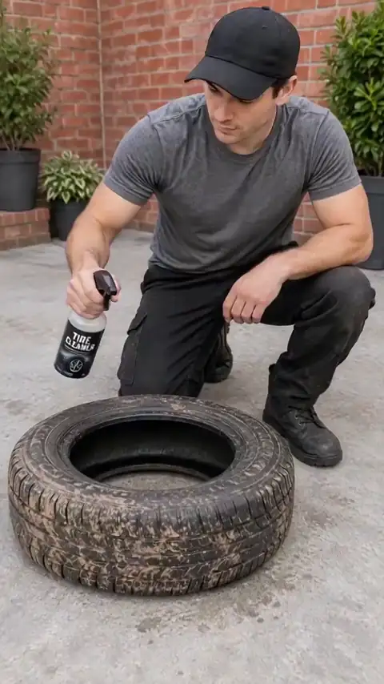

# Tire Into a Glowing Coffee Table — by @Ruslanchain

[← Back to Community Examples](../../EXAMPLES.md) · Category: Video · Model: `Seedance 2.0`

<a href="https://x.com/Ruslanchain/status/2118023608815571361"></a>

**[▶ Watch the full video on X](https://x.com/Ruslanchain/status/2118023608815571361)** — the preview above is a short silent clip.

Source: **[@Ruslanchain on X](https://x.com/Ruslanchain/status/2118023608815571361)** · Creator: [Ruslan Ai](https://x.com/Ruslanchain)

## Prompt

```text
Vertical DIY video, photorealistic style. A man in a black baseball cap, gray t-shirt and black cargo pants kneels on a concrete patio beside a red brick wall with potted plants. He sprays foaming cleaner onto a filthy mud-caked car tire, scrubs it with a brush until white foam drips down, then wipes the tire spotless black with a cloth. He fits a round plywood disc inside the tire, drives screws with a yellow cordless drill, attaches three angled wooden legs, flips the tire upright into a sturdy table base and sets a round glass top on it. He coils a warm white LED strip around the inner rim, places the glass back on top, and plugs in a power cord from the side of the tire so the LEDs glow through the glass. The scene transitions to a cozy living room at night with a beige sectional sofa, a floor lamp and a round jute rug, where the glowing tire coffee table now sits as the centerpiece. The camera slowly pushes in on the tabletop, revealing a hypnotic infinite mirror tunnel of repeating golden LED rings receding into darkness. Warm ambient lighting, smooth camera movements, satisfying transformation montage, high detail, realistic textures and reflections.
```

## Try it

Paste the prompt into **[vinano.ai](https://vinano.ai?utm_source=github&utm_medium=readme&utm_campaign=awesome-image-video-prompts-updating&utm_content=x-page-try)** to generate your own version.

> The video and prompt belong to @Ruslanchain ([original post](https://x.com/Ruslanchain/status/2118023608815571361)) and are shown here with credit for reference. Creators can ask for changes or removal by opening an issue.
