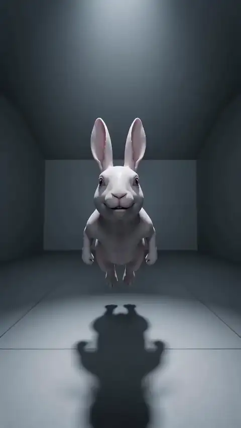

# Absurd Animated Music Short — by @XiaoZhe1984

[← Back to Community Examples](../../EXAMPLES.md) · Category: Video · Model: `Seedance 2.0`

<a href="https://x.com/XiaoZhe1984/status/2117995741616721964"></a>

**[▶ Watch the full video on X](https://x.com/XiaoZhe1984/status/2117995741616721964)** — the preview above is a short silent clip.

Source: **[@XiaoZhe1984 on X](https://x.com/XiaoZhe1984/status/2117995741616721964)** · Creator: [小喆（XiaoZhe）](https://x.com/XiaoZhe1984)

## Prompt

```text
Generate a 10-second vertical-screen absurd animated music short film. The scene is a gray, dim, empty indoor room with a low-saturation cool gray tone; the walls and floor are simple and oppressive, with a fixed first-person camera perspective. The main subject is an original classic-animation-style rabbit character, with smooth hairless skin all over, pure grayish-white skin, slightly widened eyes, and a stiff smile; the overall design does not correspond to any existing IP character. At the opening, the rabbit is close to the camera and facing it directly, suspended motionless for half a second, and says clearly in an emotionless, hoarse, slightly distorted voice: "Hello, my friend." The next second, the rabbit suddenly flies upward and enters an extremely fast, frantic, continuous midair spin, with its body rotating at high speed around its own vertical axis, forming a blurred spinning afterimage while still maintaining the grayish-white hairless rabbit outline. The camera maintains the first-person perspective throughout and follows quickly, always keeping the spinning rabbit locked at the center of the frame; the background room produces a strong sense of rotational motion and slight camera shake, with an absurd, tense, and hypnotically bizarre rhythm. While spinning at high speed, the rabbit continuously sings in a hoarse singing voice: "这回忆的漩涡~快要把我吞没~求你别离开我～" The vocals are clear, accompanied by fast drumbeats, low-frequency drums, and electronic accompaniment, and the music rhythm is synchronized with the rotation speed. No subtitles, text, stylized captions, watermarks, or interface elements of any kind.
```

## Try it

Paste the prompt into **[vinano.ai](https://vinano.ai?utm_source=github&utm_medium=readme&utm_campaign=awesome-image-video-prompts-updating&utm_content=x-page-try)** to generate your own version.

> The video and prompt belong to @XiaoZhe1984 ([original post](https://x.com/XiaoZhe1984/status/2117995741616721964)) and are shown here with credit for reference. Creators can ask for changes or removal by opening an issue.
