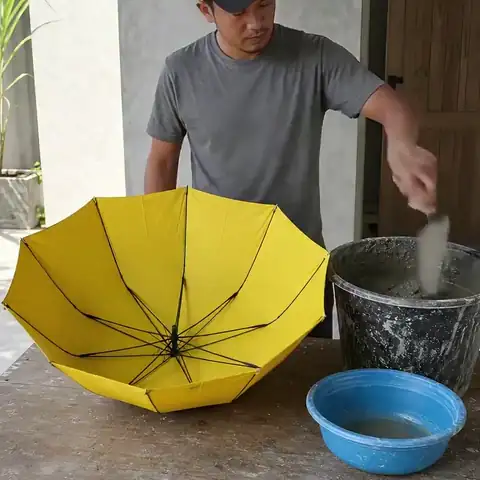

# Umbrella Into a Stone Sink — by @Rajrana12476547

[← Back to Community Examples](../../EXAMPLES.md) · Category: Video · Model: `Seedance 2.0`

<a href="https://x.com/Rajrana12476547/status/2116908365364256821"></a>

**[▶ Watch the full video on X](https://x.com/Rajrana12476547/status/2116908365364256821)** — the preview above is a short silent clip.

Source: **[@Rajrana12476547 on X](https://x.com/Rajrana12476547/status/2116908365364256821)** · Creator: [Linh Ai](https://x.com/Rajrana12476547)

## Prompt

```text
A realistic DIY craft video filmed on a covered patio with a concrete wall and wooden door in the background. A man in a gray t-shirt and black cap stands at a rustic wooden table where an open yellow umbrella lies upside down like a mold. He scoops wet gray cement from a black bucket with a trowel and fills the umbrella, then presses a blue plastic bowl into the center of the cement and smooths the surface with his hands. He arranges smooth river pebbles in a ring around the bowl, pressing them into the cement. After the concrete sets, he lifts out the blue bowl, peels away the yellow umbrella fabric, and reveals an octagonal concrete sink with pebbles embedded around its rim. He drills a drain hole in the center with a cordless drill, wipes the basin clean with a cloth, paints the whole sink white with a brush, then spray paints the pebbles glossy blue. Final scene shows the finished designer sink installed in a modern bathroom with a chrome faucet, where the man washes his hands under running water. Smooth handheld camera, natural daylight, satisfying transformation, tutorial style.
```

## Try it

Paste the prompt into **[vinano.ai](https://vinano.ai?utm_source=github&utm_medium=readme&utm_campaign=awesome-image-video-prompts-updating&utm_content=x-page-try)** to generate your own version.

> The video and prompt belong to @Rajrana12476547 ([original post](https://x.com/Rajrana12476547/status/2116908365364256821)) and are shown here with credit for reference. Creators can ask for changes or removal by opening an issue.
