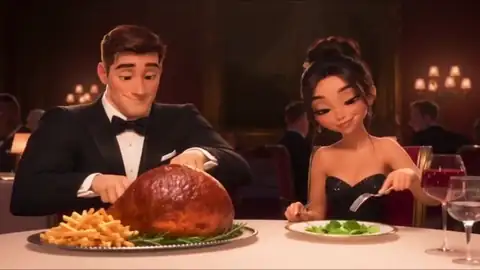

# Midnight Food Adventure 3D Comedy — by @Lianaalane

[← Back to Community Examples](../../EXAMPLES.md) · Category: Video · Model: `Seedance 2.0`

<a href="https://x.com/Lianaalane/status/2116402455315718306"></a>

**[▶ Watch the full video on X](https://x.com/Lianaalane/status/2116402455315718306)** — the preview above is a short silent clip.

Source: **[@Lianaalane on X](https://x.com/Lianaalane/status/2116402455315718306)** · Creator: [liana](https://x.com/Lianaalane)

## Prompt

```text
Create a high-quality, cinematic 3D animated comedy video featuring a cute young couple enjoying a romantic dinner at an elegant luxury restaurant. The handsome young man wears a stylish black tuxedo, while the beautiful girl wears a glamorous black evening gown with her hair tied in an elegant bun. They sit together at a beautifully decorated table with warm golden lighting, enjoying a delicious roasted turkey with crispy fries and vegetables. The girl playfully offers him a bite of food, and they exchange sweet, romantic smiles. After dinner, the couple drives home through a beautiful city at night, with glowing streetlights and charming buildings in the background. The girl arrives at her luxurious home, quietly enters the house, and heads straight to the kitchen. She opens the refrigerator and excitedly grabs a huge roasted turkey, potato chips, chocolates, cookies, burgers, and plenty of delicious snacks. In the next scene, she sits comfortably on a luxurious sofa surrounded by mountains of junk food, happily eating everything with a big smile on her face. End with a wide cinematic shot revealing the entire living room filled with snacks and food, creating a funny and adorable midnight food-craving moment. Use expressive cartoon facial animations, detailed food textures, smooth character movements, realistic lighting, beautiful camera transitions, and premium Pixar-inspired 3D animation quality. Keep the characters' appearance consistent throughout the video, with no character duplication, morphing, or visual glitches.
```

## Try it

Paste the prompt into **[vinano.ai](https://vinano.ai?utm_source=github&utm_medium=readme&utm_campaign=awesome-image-video-prompts-updating&utm_content=x-page-try)** to generate your own version.

> The video and prompt belong to @Lianaalane ([original post](https://x.com/Lianaalane/status/2116402455315718306)) and are shown here with credit for reference. Creators can ask for changes or removal by opening an issue.
