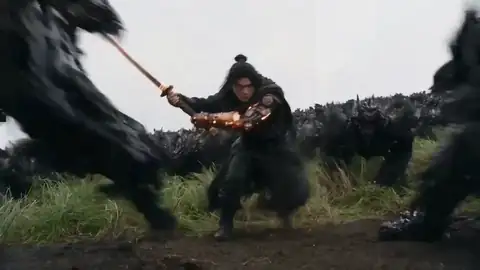

# Dark Fantasy Wuxia Battle — by @ZDuo_MoreAi

[← Back to Community Examples](../../EXAMPLES.md) · Category: Video · Model: `Seedance 2.0`

<a href="https://x.com/ZDuo_MoreAi/status/2121076838600487401"></a>

**[▶ Watch the full video on X](https://x.com/ZDuo_MoreAi/status/2121076838600487401)** — the preview above is a short silent clip.

Source: **[@ZDuo_MoreAi on X](https://x.com/ZDuo_MoreAi/status/2121076838600487401)** · Creator: [ZDuo.MoreAi](https://x.com/ZDuo_MoreAi)

## Prompt

```text
Cinematic dark fantasy wuxia action scene, low angle dynamic tracking shot. A male warrior in black martial robes and arm guards stands in a tall grass field under an overcast gray sky. He spins dynamically, slashing a glowing fiery sword that leaves arc trails of bright orange fire and sparks. A massive swarm of black shadow beasts charges across the field. He triggers a powerful ground shockwave that blasts dirt, smoke, and embers into the air. A circular matrix of glowing red target reticles and energy lasers shoots outward into the monster swarm. The warrior then rests his blazing sword on his shoulder and walks forward in slow motion through floating embers, smoke, and dissolving black ash. Photorealistic VFX, motion blur, 8k resolution, hyper-detailed.
```

## Try it

Paste the prompt into **[vinano.ai](https://vinano.ai?utm_source=github&utm_medium=readme&utm_campaign=awesome-image-video-prompts-updating&utm_content=x-page-try)** to generate your own version.

> The video and prompt belong to @ZDuo_MoreAi ([original post](https://x.com/ZDuo_MoreAi/status/2121076838600487401)) and are shown here with credit for reference. Creators can ask for changes or removal by opening an issue.
