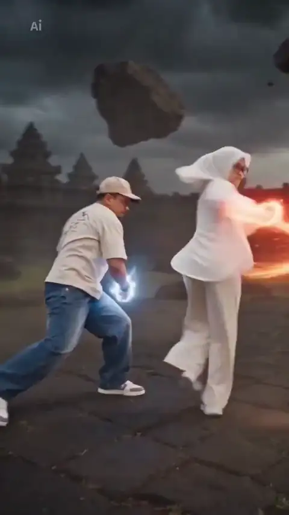

# Ice Dragon vs Fire Phoenix — by @zaviaanroy

[← Back to Community Examples](../../EXAMPLES.md) · Category: Video · Model: `Seedance 2.0`

<a href="https://x.com/zaviaanroy/status/2117760569201848392"></a>

**[▶ Watch the full video on X](https://x.com/zaviaanroy/status/2117760569201848392)** — the preview above is a short silent clip.

Source: **[@zaviaanroy on X](https://x.com/zaviaanroy/status/2117760569201848392)** · Creator: [Zaviaan](https://x.com/zaviaanroy)

## Prompt

```text
Create an ultra-realistic, cinematic fantasy battle between two powerful martial arts warriors in a mystical ancient arena.

Scene 1: A dramatic cinematic title reveal featuring a gigantic blue ice dragon on the left and a magnificent golden fire phoenix on the right, surrounded by lightning, flames, dark storm clouds, and floating rocks.

Scene 2: Two martial arts fighters, one wearing a white outfit with glowing blue ice energy and the other wearing a white outfit with blazing orange fire energy, begin an intense kung fu battle. They perform powerful kicks, punches, flying attacks, and supernatural energy strikes.

Scene 3: Both warriors jump high into the sky, releasing massive blue and orange energy beams from their hands. Giant floating rocks surround them as the two energy powers collide.

Scene 4: The blue ice dragon emerges behind the blue warrior while the golden fire phoenix appears behind the orange warrior. Both mythical creatures roar and unleash their ultimate powers.

Scene 5: An enormous blue-and-orange energy explosion fills the sky, creating a spectacular cinematic shockwave with flying debris, magical particles, fire, ice, and lightning.

Visual style: Hyper-realistic 3D CGI, epic fantasy movie cinematography, Unreal Engine 5 quality, ultra-detailed characters, volumetric lighting, dramatic camera movements, slow motion action, realistic physics, 4K resolution, vertical 9:16 aspect ratio.

No cartoon style, no blurry faces, no distorted bodies, no extra limbs, no watermark.
```

## Try it

Paste the prompt into **[vinano.ai](https://vinano.ai?utm_source=github&utm_medium=readme&utm_campaign=awesome-image-video-prompts-updating&utm_content=x-page-try)** to generate your own version.

> The video and prompt belong to @zaviaanroy ([original post](https://x.com/zaviaanroy/status/2117760569201848392)) and are shown here with credit for reference. Creators can ask for changes or removal by opening an issue.
