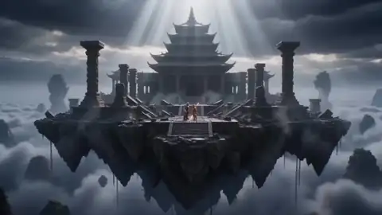

# Titan vs Warrior Floating Temple — by @draavenai

[← Back to Community Examples](../../EXAMPLES.md) · Category: Video · Model: `Seedance 2.0`

<a href="https://x.com/draavenai/status/2122907719191470174"></a>

**[▶ Watch the full video on X](https://x.com/draavenai/status/2122907719191470174)** — the preview above is a short silent clip.

Source: **[@draavenai on X](https://x.com/draavenai/status/2122907719191470174)** · Creator: [Draaven](https://x.com/draavenai)

## Prompt

```text
Create an epic ultra-realistic 3D fantasy action movie set in an ancient Chinese temple floating among dark stormy mountains. A giant muscular purple titan wearing golden armor and a powerful golden gauntlet faces a legendary monkey warrior dressed in traditional red and golden battle armor, holding a magical golden staff. The two warriors stand face to face before an intense battle begins. The monkey warrior spins his glowing golden staff, creating powerful golden energy waves. The purple titan unleashes mysterious purple lightning energy. Both warriors clash in an explosive magical battle, destroying the ancient stone platform as rocks fly through the air. Dramatic close-up shots, powerful fight choreography, cinematic slow motion, realistic facial expressions, spectacular magical visual effects, volumetric lighting, detailed 3D animation, Hollywood fantasy movie quality, 4K resolution, vertical 9:16 format.
```

## Try it

Paste the prompt into **[vinano.ai](https://vinano.ai?utm_source=github&utm_medium=readme&utm_campaign=awesome-image-video-prompts-updating&utm_content=x-page-try)** to generate your own version.

> The video and prompt belong to @draavenai ([original post](https://x.com/draavenai/status/2122907719191470174)) and are shown here with credit for reference. Creators can ask for changes or removal by opening an issue.
