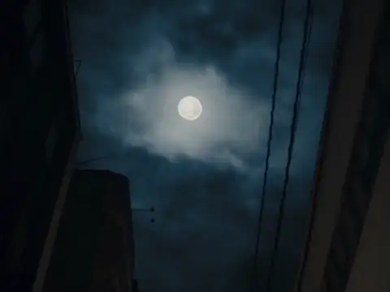

# Witch on a Broomstick Over the City — by @AIwithMinal

[← Back to Community Examples](../../EXAMPLES.md) · Category: Video · Model: `Seedance 2.0`

<a href="https://x.com/AIwithMinal/status/2117120914139619479"></a>

**[▶ Watch the full video on X](https://x.com/AIwithMinal/status/2117120914139619479)** — the preview above is a short silent clip.

Source: **[@AIwithMinal on X](https://x.com/AIwithMinal/status/2117120914139619479)** · Creator: [AIwithMinal](https://x.com/AIwithMinal)

## Prompt

```text
Create an ultra-realistic cinematic fantasy video featuring a mysterious young witch flying through a dark city on a magical broomstick under a glowing full moon. Show dramatic clouds, blue magical smoke, and a mysterious night atmosphere. The witch wears a black pointed hat, a stylish dark outfit, and has long flowing hair. Capture her flying between tall buildings and swooping down through busy neon-lit streets. Add realistic motion, glowing magical effects, cinematic camera movements, dramatic lighting, and stunning visual details. High-end fantasy movie style, 4K, photorealistic, smooth animation.
```

## Try it

Paste the prompt into **[vinano.ai](https://vinano.ai?utm_source=github&utm_medium=readme&utm_campaign=awesome-image-video-prompts-updating&utm_content=x-page-try)** to generate your own version.

> The video and prompt belong to @AIwithMinal ([original post](https://x.com/AIwithMinal/status/2117120914139619479)) and are shown here with credit for reference. Creators can ask for changes or removal by opening an issue.
