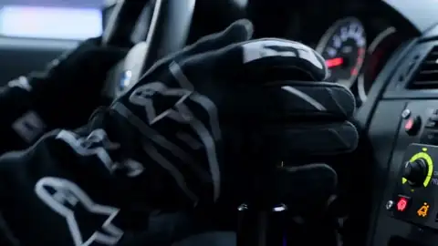

# Night Street Racing Sequence — by @CharaspowerAI

[← Back to Community Examples](../../EXAMPLES.md) · Category: Video · Model: `Seedance 2.0`

<a href="https://x.com/CharaspowerAI/status/2039651574297792688"></a>

**[▶ Watch the full video on X](https://x.com/CharaspowerAI/status/2039651574297792688)** — the preview above is a short silent clip.

Source: **[@CharaspowerAI on X](https://x.com/CharaspowerAI/status/2039651574297792688)** · Creator: [Pierrick Chevallier | IA](https://x.com/CharaspowerAI)

## Prompt

```text
cinematic street racing sequence at night, a focused driver inside a high-performance car grips the steering wheel, intense eye focus, city lights reflecting on windshield, tension building before sudden acceleration

camera: rapid multi-angle system with seamless transitions, interior close-up → over-the-shoulder → exterior tracking → low ground shots, ultra dynamic camera movement, whip pans + speed ramp transitions + motion blur masking cuts, continuous flow illusion

(0-2s) interior close-up on driver, hand tightens on gear shift, subtle breathing, dashboard lights glowing
(2-4s) over-the-shoulder shot, road ahead stretching into neon-lit city, engine vibration building
(4-6s) extreme close-up on finger pressing NOS button, instant ignition reaction
(6-8s) explosive acceleration, camera snaps to exterior side tracking shot, car launches forward with violent speed surge
(8-10s) ultra low ground shot near asphalt, wheels spinning at extreme velocity, environment streaking past
(10-12s) high-speed chase through tight streets, sharp turns, camera whip pans between angles, reflections and light trails enhancing speed

Dense urban night environment, wet asphalt reflecting neon lights, tunnel passages, street lights streaking, high-speed city atmosphere
Ultra realistic, fast and furious inspired energy, photorealistic lighting, intense motion blur, high contrast neon reflections, cinematic depth of field, extreme sense of speed, fluid transitions, no distortion, no stretching
```

## Try it

Paste the prompt into **[vinano.ai](https://vinano.ai?utm_source=github&utm_medium=readme&utm_campaign=awesome-image-video-prompts-updating&utm_content=x-page-try)** to generate your own version.

> The video and prompt belong to @CharaspowerAI ([original post](https://x.com/CharaspowerAI/status/2039651574297792688)) and are shown here with credit for reference. Creators can ask for changes or removal by opening an issue.
