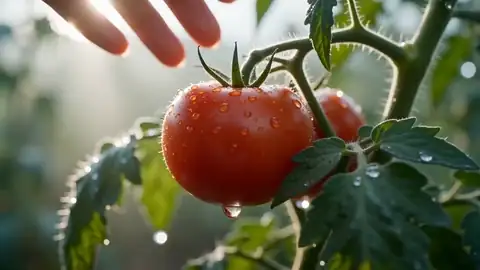

# Modern Rural Aesthetics Macro — by @johnAGI168

[← Back to Community Examples](../../EXAMPLES.md) · Category: Video · Model: `Seedance 2.0`

<a href="https://x.com/johnAGI168/status/2021818021354848258"></a>

**[▶ Watch the full video on X](https://x.com/johnAGI168/status/2021818021354848258)** — the preview above is a short silent clip.

Source: **[@johnAGI168 on X](https://x.com/johnAGI168/status/2021818021354848258)** · Creator: [John](https://x.com/johnAGI168)

## Prompt

```text
【风格】
现代田园美学(Modern Rural Aesthetics)，电影级广告大片质感(Cinematic Commercial)，索尼A7S3/电影机拍摄，4K/8K超清，极致微距(Extreme Macro)，自然通透光感，治愈系ASMR，无古装剧感。

【场景】
一个打理得井井有条的现代农家开放式厨房，背景是郁郁葱葱的菜园，阳光明媚。

【角色】
现代田园博主(Modern Creator)，黑色长发随意用一根木簪挽起，身穿深蓝色的舒适棉麻套装(Modern Linen Outfit)，妆容清透，眼神专注宁静。

【分镜详解】
[00:00-00:05] 镜头1：清晨采摘(The Freshness)
画面：高清特写。清晨的阳光侧逆光打在植物上。
动作：博主的一双素手（手指修长干净）从藤蔓上摘下一个带着晶莹露水的鲜红番茄。
细节：焦点极锐，能看清番茄表面的绒毛和水珠滑落的轨迹。背景是虚化的高级绿。

[00:05-00:10] 镜头2：极致手作(The Craft)
画面：室内灶台，充满生活气息但一尘不染。
动作：博主正在切菜，动作熟练利落（非表演性质）。
细节：微距镜头捕捉刀刃切开食材的瞬间，汁水飞溅。接着切换到土灶膛里跳动的橙色火焰，光影温暖而真实。

[00:10-00:15] 镜头3：静谧时光(The Moment)
画面：全景/中景。
动作：一道精致的家常菜被端上院子里的原木长桌。博主安静地坐下，轻轻整理了一下耳边的碎发，夹起一口菜。
氛围：蒸汽在逆光中缓缓升腾，画面安静得仿佛能听到风声，展现出一种现代人向往的极致松弛感。
```

## Try it

Paste the prompt into **[vinano.ai](https://vinano.ai?utm_source=github&utm_medium=readme&utm_campaign=awesome-image-video-prompts-updating&utm_content=x-page-try)** to generate your own version.

> The video and prompt belong to @johnAGI168 ([original post](https://x.com/johnAGI168/status/2021818021354848258)) and are shown here with credit for reference. Creators can ask for changes or removal by opening an issue.
