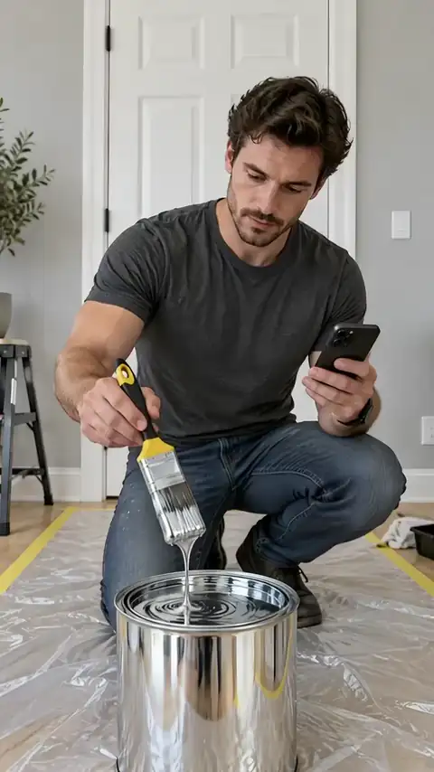

# Paint That Turns a Door Into a Mirror — by @Rajrana12476547

[← Back to Community Examples](../../EXAMPLES.md) · Category: Video · Model: `Seedance 2.0`

<a href="https://x.com/Rajrana12476547/status/2116533263543984512"></a>

**[▶ Watch the full video on X](https://x.com/Rajrana12476547/status/2116533263543984512)** — the preview above is a short silent clip.

Source: **[@Rajrana12476547 on X](https://x.com/Rajrana12476547/status/2116533263543984512)** · Creator: [Linh Ai](https://x.com/Rajrana12476547)

## Prompt

```text
Vertical photorealistic video in a bright modern home interior. A man in a fitted gray t-shirt, blue jeans and a smartwatch kneels on a plastic drop cloth bordered with yellow tape, dipping a large yellow-and-black paintbrush into an open can of thick liquid chrome while glancing at his smartphone. Extreme close-up: molten silver paint drips slowly off the bristles back into the rippling mirror-like can. Cut to a white six-panel interior door: his hand sweeps the brush across a panel and the liquid chrome spreads into a flawless reflective mirror finish, each smooth stroke coating more surface. Sequential shots show the panels, stiles and edges being painted until the entire door gleams like polished metal, reflecting ceiling lights and the room around it. Final wide shot: the completed door is a perfect mirror showing the man holding his phone and brush, a camera on a tripod and the hallway behind him. Satisfying DIY transformation, natural daylight, crisp textures, realistic metallic reflections, steady handheld camera with slow push-ins on the brush strokes.
```

## Try it

Paste the prompt into **[vinano.ai](https://vinano.ai?utm_source=github&utm_medium=readme&utm_campaign=awesome-image-video-prompts-updating&utm_content=x-page-try)** to generate your own version.

> The video and prompt belong to @Rajrana12476547 ([original post](https://x.com/Rajrana12476547/status/2116533263543984512)) and are shown here with credit for reference. Creators can ask for changes or removal by opening an issue.
