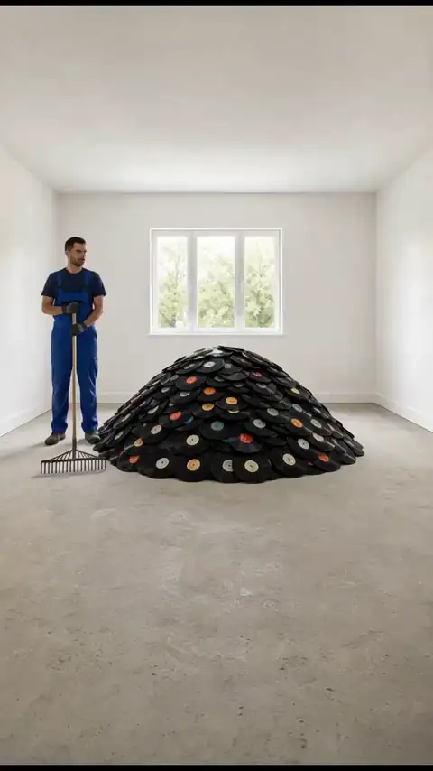

# Vinyl Records Epoxy Floor — by @Ruslanchain

[← Back to Community Examples](../../EXAMPLES.md) · Category: Video · Model: `Seedance 2.0`

<a href="https://x.com/Ruslanchain/status/2116161380516601859"></a>

**[▶ Watch the full video on X](https://x.com/Ruslanchain/status/2116161380516601859)** — the preview above is a short silent clip.

Source: **[@Ruslanchain on X](https://x.com/Ruslanchain/status/2116161380516601859)** · Creator: [Ruslan Ai](https://x.com/Ruslanchain)

## Prompt

```text
Vertical video, static wide shot of an empty white room with a large window showing green trees. A man in blue overalls and work gloves rakes a huge mound of black vinyl records on the bare concrete floor, spreading the records flat and evenly across the entire floor like colorful tiles. A woman in red overalls, black t-shirt and green rubber gloves enters carrying a white bucket and pours thick creamy white self-leveling epoxy resin over the records; the glossy liquid flows outward until the whole floor is submerged in bright white. Cut to the cured floor: a worker in a yellow hi-vis vest, red pants and rubber boots polishes the surface with a rotary floor buffer, revealing the vinyl records embedded under a crystal-clear glossy epoxy layer, their colorful labels shining through. Finally two men dressed in black carry in a wooden bed frame, assemble it in the center of the room, then place a white mattress, pillows and a gray duvet, completing a stylish bedroom with a vinyl record floor. Bright natural daylight, clean minimalist aesthetic, satisfying DIY renovation timelapse style, smooth transitions, photorealistic detail, 4K quality.
```

## Try it

Paste the prompt into **[vinano.ai](https://vinano.ai?utm_source=github&utm_medium=readme&utm_campaign=awesome-image-video-prompts-updating&utm_content=x-page-try)** to generate your own version.

> The video and prompt belong to @Ruslanchain ([original post](https://x.com/Ruslanchain/status/2116161380516601859)) and are shown here with credit for reference. Creators can ask for changes or removal by opening an issue.
