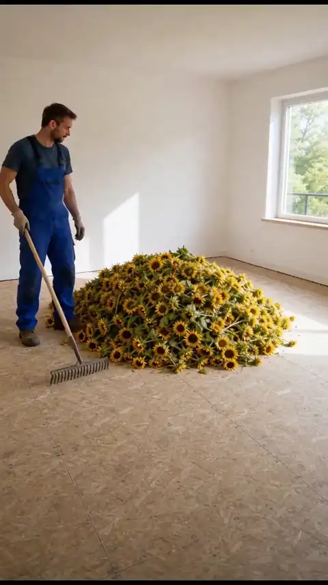

# Sunflowers Into a Bedroom Floor — by @Ruslanchain

[← Back to Community Examples](../../EXAMPLES.md) · Category: Video · Model: `Seedance 2.0`

<a href="https://x.com/Ruslanchain/status/2116426434025504817"></a>

**[▶ Watch the full video on X](https://x.com/Ruslanchain/status/2116426434025504817)** — the preview above is a short silent clip.

Source: **[@Ruslanchain on X](https://x.com/Ruslanchain/status/2116426434025504817)** · Creator: [Ruslan Ai](https://x.com/Ruslanchain)

## Prompt

```text
Vertical video in a bright empty room with white walls, a large window and a raw wooden subfloor. A man in blue overalls and work gloves rakes a big pile of fresh sunflowers, spreading them evenly across the entire floor with smooth sweeping motions until the whole room is covered in blooms. Two women in red overalls then carry white buckets and pour thick creamy white epoxy resin over the sunflowers, the liquid flowing outward and slowly submerging the flowers. Next, a worker in a high-visibility vest polishes the hardened surface with a rotary floor machine, revealing a glossy clear resin floor with vivid sunflowers embedded inside like a field frozen under glass. Finally, two women carry in a wooden bed frame, place the mattress, spread a white duvet and pillows, and add nightstands with warm lamps. The video ends with a slow pan across the finished cozy bedroom, sunlight streaming through the window, the mirror-like sunflower floor reflecting the bed. Realistic style, smooth camera movement, satisfying step-by-step transformation, bright natural daylight, high detail.
```

## Try it

Paste the prompt into **[vinano.ai](https://vinano.ai?utm_source=github&utm_medium=readme&utm_campaign=awesome-image-video-prompts-updating&utm_content=x-page-try)** to generate your own version.

> The video and prompt belong to @Ruslanchain ([original post](https://x.com/Ruslanchain/status/2116426434025504817)) and are shown here with credit for reference. Creators can ask for changes or removal by opening an issue.
